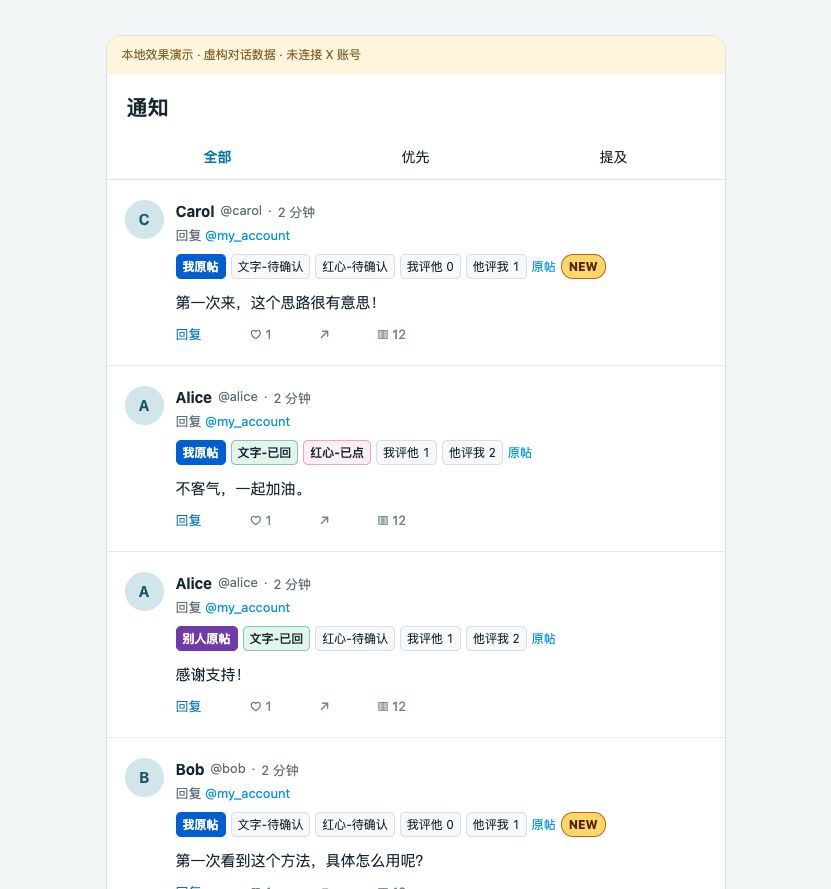
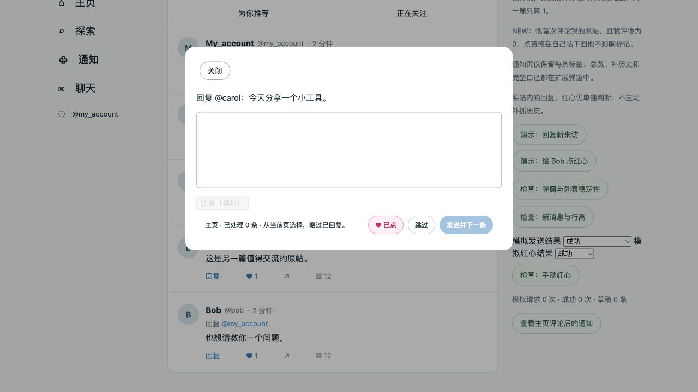

<p align="center">
  
</p>

# 回过了 · X 通知助手

**分清谁的原帖，记住是否回过，把下一次回复留给你决定。**

一个 Chrome 扩展，给 X 通知补上原帖归属、回复与点赞记录、双方互动统计。在通知和「主页 → 为你推荐」支持「发送并下一条」和「跳过」。适合经常逐条交流，又不想反复回复同一段对话的人。

**内容由你决定，每条由你确认。** 扩展不生成回复；每条回复都需用户手动确认发送，点赞与取消也需单独点击，不会自动点赞。它的用途是管理通知、减少漏回和重复回复。

*A Chrome extension with conversation context and interaction history in X notifications, plus reply-next controls for notifications and the For you feed.*

**Chrome 111+** · **Manifest V3** · **本地存储** · **无运行依赖**

> 平台规范存在灰色地带，使用仍有账号限制或封禁风险。请用于逐条阅读后的真实交流，安装前阅读下方的 [使用建议与平台风险](#使用建议与平台风险)。

[快速安装](#快速安装) · [标签说明](#标签说明) · [通知筛选](#通知筛选) · [连续回复](#连续回复) · [隐藏已完成原帖](#隐藏已完成原帖) · [数据与隐私](#数据与隐私) · [本地开发](#本地开发)

<p align="center">
  
</p>

<p align="center"><sub>使用扩展实际标签代码渲染的本地演示；账号与帖子均为虚构。</sub></p>

## 快速安装

1. 下载本仓库源码（**Code → Download ZIP**）并解压，也可以下载并解压 [0.14.1 安装包](dist/x-reply-context-0.14.1.zip)。
2. 在 Chrome 地址栏打开 `chrome://extensions`，启用右上角的「开发者模式」。
3. 点击「加载已解压的扩展程序」：源码选择 **`extension/`**；安装包选择解压后包含 `manifest.json` 的文件夹。
4. 刷新已打开的 X 页面，进入「通知」。建议把「回过了」固定到浏览器工具栏，方便查看总览与统计口径。

安装无需 Node.js、API Key 或额外账号。照常在 X 登录后使用。

**升级**：用新版本覆盖原扩展文件夹，在扩展管理页点击重新加载，再刷新 X 标签页。沿用原安装目录，避免先卸载导致本地记录丢失。

## 标签说明

标签保持一行，顺序为 **原帖归属 → 文字 → 红心 → 我评他 → 他评我 → 原帖链接 → NEW**。窄处可横向查看，整体统计与口径说明收在扩展弹窗里。

| 标签 | 表示什么 |
| --- | --- |
| **我原帖** / **别人原帖** | 蓝色 / 紫色区分整段对话最初的帖子作者；楼中楼沿用同一原帖。 |
| **文字-已回** | 在同一原帖里，找到你回复过这个人的记录。点击可查看依据。 |
| **红心-已点** | 在同一原帖里，找到你给这个人的某条帖子点过红心的记录。点击可查看依据。 |
| **我评他 N** / **他评我 M** | 双方分别评论过对方的几篇原帖，按不同原帖去重。 |
| **NEW** | 这是本地记录中他第一次评论你原帖的那条通知，且「我评他」为 0。 |
| **待确认** | 当前本地记录不足，暂时无法判断。 |

> **「待确认」不等于从未回复或点赞；数字 0 和 NEW 也不代表完整历史。** 所有判断均基于本浏览器已经读取并保留的记录。

### 同一原帖，同一个人

文字与红心分别判断，按 **当前账号 + 原帖 + 对方** 区分。你回过 Alice，不会把同帖里的 Bob 标成已回；Alice 换到另一篇原帖，也会重新判断。

「我评他 / 他评我」统计的是**评论过几篇对方的原帖**：同帖评论 3 次只算 1，包含楼中楼；点赞、在自己或第三方的原帖下回话，不增加对应方向的数字。

例如，Alice 在你的原帖留言，你回她后她又回复：显示「文字-已回、我评他 0、他评我 1」。随后你评论 Alice 的一篇原帖，数字才变成「我评他 1、他评我 1」。

NEW 只标首次评论的那条通知，后续不重复。点赞、你在自己原帖下回复她，不影响这个标记；你评论过她的原帖后，不再标 NEW。

## 通知筛选

### 点赞与关注：接收时过滤（0.14.0）

扩展弹窗提供 **「通知自动隐藏点赞消息」**、**「通知自动隐藏关注消息」** 两个独立开关，默认开启，保留手动关闭的选择。详情默认收起。

- 点赞包含：单人/多人点赞你的原帖、喜欢你的回复、多人聚合点赞。关注包含：单人/多人“关注了你”。按接口事件类型识别，评论、转帖和未知事件保留，不依据文字猜测。
- 在已核对的通知响应交给 X 渲染前过滤，覆盖 fetch / XHR 接收路径；点赞与关注不再进入虚拟列表后折叠，因此不留下逐条隐藏占位或顶部横线空白。原始互动数据仍交给本地记录链路，不影响已有评论/红心记录。
- **一批全被过滤就停下**：保留 X 游标，暂停下一次底部翻页，显示独立浮层「继续加载」。点击只放行一批原生请求；如果仍没有保留内容，再次停下。不会为找评论自动连翻多页，浮层也不占用列表顶部空间。
- 顶部增量通知继续接收，新的评论不会被底部分页暂停卡住；离开通知、切换账号和取消请求时清理等待项。回复框打开时不显示翻页浮层，不打断草稿。
- 开关变更影响后续接收；**关闭后手动刷新通知页，可恢复此前被过滤的消息**。扩展不自动刷新，不在 X 删除通知、不取消真实点赞或关注、不主动发起补抓请求。
- 当前已核对的主入口为 `NotificationsTimeline` GET，兼容通知 REST 的已知结构；未知结构、非通知操作及未支持的响应保持原样。接口变化时可能仍显示部分消息，不冒险按关键词删除评论。

### 已完成评论：保护阅读区

通知标题栏仍固定保留三个独立按钮，尺寸与位置不随数量变化：

- **隐藏已回且已点**：默认关闭。同一原帖、同一个人的文字与红心依据均已确认，才隐藏评论；待确认或只做一项保留，不跨原帖套用。
- **整理列表**：仅一次应用已加载评论的最新完成状态；不再二次折叠点赞和关注通知。
- **自动整理**：默认关闭并记住选择。每次主动操作后空闲10秒，只处理一轮视口下方600px之外的已完成评论；补位、新数据、布局滚动不再触发下一轮。当前及上方保持原状态，回复框和后台暂停。

评论折叠同时收紧卡片及原生虚拟行的边框、间距，避免每条累积1px横线。未知虚拟行结构仍由 X 原生布局处理；X 自身的媒体加载和排序变化仍可能影响位置。

这是本地显示筛选，设置和互动记录仅保存在当前 Chrome，不保证覆盖未读取历史。

## 连续回复

从通知列表点击小评论按钮，回复框底部还会显示与列表相同的原帖归属、文字/红心状态、我评他 / 他评我、原帖链接及 NEW 标记。统计口径不变，悬停可查看说明；本地记录更新时同步刷新，固定行高避免挤动输入框和操作按钮。内容较长时标签可横向滚动。

旁边的 **「他的主页 ↗」** 在新标签页打开当前回复对象的主页，保留当前草稿。楼中楼也指向当前评论者；原帖作者仍可通过「原帖」查看。账号未确认时不提供跳转；读取失败不影响正常回复、跳过或关闭；切换下一条会更新对象，并丢弃前一个对象的晚到结果。

在通知或主页的「为你推荐」「正在关注」列表点击小评论按钮，回复框下方会出现本轮已处理数量和三个按钮：

| 操作 | 行为 |
| --- | --- |
| **♡ 点赞 / ♥ 已点** | 独立手动给当前正在回复的那条帖子点赞，再次点击取消；发送、跳过均不附带点赞。 |
| **发送并下一条** | 使用 X 原生回复功能发送当前内容；确认成功且保存本地记录后，打开下一条。 |
| **跳过** | 仅跳过本轮，不标记已回；有未发送内容时尝试保存到 X 草稿，无法确认保存则暂停。 |

- 通知自动略过**同一原帖里已文字回复过的人**；主页原帖略过**自己的帖子和已评论过的原帖**，包含在该帖楼中楼的评论。只点过红心的仍展示。当前手动打开的一条由你决定是否再次回复。
- 每次下一步都从**当前页面已加载的卡片**中选择，不限于当前条下方；本轮已发送或跳过的卡片不重复出现，点赞、关注等聚合通知不进入候选。
- **新消息不打断当前编辑**，下一步时如已加载也可以处理。候选移出页面后可改选其他已加载项；不自动翻页补抓，内部每次最多分类 100 条。
- 主页「为你推荐」和「正在关注」均可启动，回复框显示本轮所属页签。只选择该页签当前已加载的卡片；切换页签或账号立即结束本轮，旧异步结果不会在另一列表继续操作。已经发出的回复，其成功回执仍沿用统一链路保存。自定义页签暂不启动连续处理，原生评论仍照常记录。主页不插入逐条标签或额外行高。
- 「主页隐藏自己的内容及已完成原帖」仍仅作用于「为你推荐」，本次不扩展隐藏范围。
- 发送失败或结果不明会停下，不自动重发。
- 红心按钮复用当前帖的 X 原生控件，成功回执沿用既有流程保存；不把同一对话中其他帖的红心当作当前帖已点赞。状态随 X 更新或回滚，不代表已经收到成功回执。来源卡片移出列表或控件不可用时禁用，避免误点其他帖。
- 手动关闭回复框即可退出。X 原来的回复按钮仍只发送本条；每条是否发送都由你确认。

<details>
<summary>查看连续回复界面</summary>

<p align="center">
  
</p>

演示使用虚构数据。扩展不生成回复内容；如同时使用 XReply，先接受要发送的文字，待逐字填入或改写完成后再发送。当前适配依据为 XReply 0.3.2 的页面标记，其他版本需要重新确认。

</details>

## 隐藏已完成原帖

点击扩展图标，开启 **「主页隐藏自己的内容及已完成原帖」**。默认关闭，设置保存在当前 Chrome；开启后无需使用连续回复按钮，照常点 X 原生小评论和红心即可。

- 只在 **主页 → 为你推荐** 生效：当前账号评论过该原帖（含楼中楼），**且给这篇原帖本身点过红心**，才折叠对应卡片。给同一对话中的另一条回复点红心不算。
- **自己的帖子和回复直接隐藏**，不要求评论或红心。别人回复你原帖的卡片不会因此一起隐藏。
- 别人的原帖仅评论、仅点赞或证据待确认时均保留；别人的回复卡片不在完成项筛选范围内，也不把一个人的其他帖子一起隐藏。
- 等成功记录保存后再判断；回复框打开时暂不折叠或恢复，关闭后处理，避免丢失当前操作目标。新加载和重绘的卡片也会检查，来源节点不删除。
- 关闭开关即可恢复当前已加载卡片，互动记录保留；“正在关注”、自定义页签和通知页不筛选。取消原帖红心并读取到成功记录后，也会恢复。

折叠会让后面的帖子补位；X 自身的虚拟列表、新消息排序和媒体加载仍可能影响滚动位置。本功能只整理已加载内容，不额外请求历史，不自动发送或点赞。

## 记录如何积累

**照常浏览和互动即可。** 支持在主页直接点红心或小评论按钮，也支持在通知里直接回复；成功操作和页面返回的明确状态会被记录，无需先进入帖子详情。

主页、通知、详情和原生回复共用成功回执的保存流程，支持普通与长评论。只有收到匹配账号和回复目标的成功回执，且本地保存完成，才自动进入下一条；「我评他」仍按不同原帖数去重。

需要补充旧回复时，点击扩展图标 →「补充我的历史回复」，在自己的「回复」页向下浏览，然后返回通知。这个步骤可选，不会自动扫描完整历史。手机或其他浏览器上的操作，也要在当前浏览器加载到相关内容后才能识别。

标签区域预留固定高度，打开回复框时保留背景标签并同步更新数字、回复与红心状态，减少插件内容变化引起的列表跳动。成功回复统一保存一次，再进入下一条；X 自身的新消息排序、媒体加载等变化仍可能影响位置。

## 数据与隐私

扩展读取 X 页面已经返回的相关帖子数据，在 `chrome.storage.local` 保存互动关系；不主动补抓历史，不要求额外登录，也没有独立服务端或统计上传。

| 访问范围 / 权限 | 用途 |
| --- | --- |
| `https://x.com/*`、`https://twitter.com/*` | 识别页面返回的帖子与互动结果，在通知和回复框显示提示。 |
| `storage` | 保存本地记录。 |
| `unlimitedStorage` | 容纳含帖子片段的记录；代码仍限制每类记录的数量。 |

本地保存用户 ID / 用户名、帖子关系、点赞状态、互动统计及最多 200 字符的帖子片段。各类记录最多 **10,000 条**，保留 **90 天**（按最后观察时间）。到期或淘汰后，统计可能减少，证据不足时恢复「待确认」。

不读取请求头、Cookie 或私信接口；不保存未发送的草稿内容。回复发送和草稿保存由 X 原生功能完成，草稿保存在 X 中。卸载扩展会删除该扩展的本地数据。

## 兼容性与限制

- 面向桌面 Chrome，最低版本由扩展清单设为 111；其他浏览器与移动端尚未验证。
- 依赖 X 网页的接口与页面结构，站点更新可能导致采集或按钮失效；匹配不到可靠信息时保留「待确认」。
- 已回状态表示曾读取到回复依据，不保证回复尚未被删除；红心以本机最后观察到的状态为准。
- 连续回复的成功、失败、跳过、草稿和新消息场景已做本地模拟；真实页面验证了按钮与布局，完整实发及原生草稿保存链路仍待正常使用确认。

这是独立开发的浏览器扩展，与 X 官方无关联。

### 使用建议与平台风险

**这是逐条人工操作的效率工具，但不等于获得 X 官方认可。** 与无人值守的自动回复、自动点赞工具相比，每条人工阅读、决定内容和确认发送，可以减少自动批量互动的风险；具体用法仍很重要。

以下是**使用行为的定性比较，不是 X 官方评级或实测封号概率**。表中的“相对较低”不消除各场景共有的技术接入风险。

| 使用场景 | 行为风险比较 | 使用边界 |
| --- | --- | --- |
| 管理自己的通知，逐条阅读，自己写内容，回复已经与你互动的人 | **相对较低** | 保留人工判断，围绕当前话题交流；仍不能保证账号安全。 |
| 在「为你推荐」里高频连续回复陌生人，或配合 AI 批量发送相似内容 | **中到高** | 人工点击不改变批量、重复、无关或未经请求互动的性质。 |
| 批量引流、刷互动、关键词式模板回复 | **高** | 可能直接违反 X 的垃圾互动与平台操纵规则，不属于本工具的使用目的。 |

**技术路径仍是灰色地带和主要风险来源。** X 的[开发者指南](https://docs.x.com/developer-guidelines)允许用户主动点击第三方应用的点赞按钮，但[自动化规则](https://help.x.com/en/rules-and-policies/x-automation)明确限制非 API 网页自动化，违规可能导致永久封禁。本扩展通过网页脚本读取并缓存接口响应、触发原生控件；人工逐次确认、本地存储、不主动补抓历史，均不能视为这些技术路径已获许可。内部 GraphQL 路径也不等于官方开放 API 授权。[服务条款](https://x.com/en/tos)对未授权采集的限制仍需考虑。

**建议谨慎用于个人通知管理，不把它当作增长或批量回复工具。** 阅读上下文后决定是否回复，避免重复模板、无关引流和未经请求的批量接触；不要为了处理更多条目而跳过人工判断。X 的[真实性政策](https://help.x.com/en/rules-and-policies/authenticity)适用于实际互动行为，不会因使用插件或手动点击而豁免。

目前没有本项目的系统性账号安全研究，不能据此声称“正常使用不会封号”、给出安全频率，或保证不存在封号案例。完整的技术接入与数据缓存风险，见 [X 使用规范核查报告](docs/research/x-compliance-0.5.1.md)；其中的技术风险评级与上表的行为风险比较是不同维度。

## 本地开发

需要 **Node.js 22+**。无 npm 依赖，无需执行 `npm install`。

```sh
npm test          # 核心逻辑与请求回执检查
npm run preview  # 本地模拟通知，不连接 X 账号
npm run package  # 生成 dist/ 下的安装包
```

演示入口：`http://127.0.0.1:5818/notifications`、`http://127.0.0.1:5818/home`。打包脚本另外依赖系统提供的 `zip`、`unzip` 命令。

```text
extension/
  core.js          数据归一化、原帖归属与互动统计
  observe.js       观察页面响应与操作回执
  notification-network.js  通知接收过滤、游标与空批分页暂停
  background.js    合并并保存本地记录
  content.*        通知标签与布局
  continuous.js    连续回复与草稿流程
  home-filter.js   主页自己的内容与完成项筛选
  card-filter.js   两处列表共用的卡片折叠与异步校验
  notification-filter.js  通知标题栏开关、空闲调度与完成项规则
  popup.*          总览、使用说明与历史入口
tests/             逻辑检查、本地演示和布局检查
scripts/           预览与打包
assets/readme/     首页视觉素材
```

0.14.1 修复已完成评论自动整理在补位后重复触发的问题，真实过滤与顶部占位已核对，见 [0.14.1 记录](docs/reviews/0.14.1.md)。0.14.0 将点赞/关注改为接收时过滤，增加空批单步继续并减少隐藏占位，见 [0.14.0 验证记录](docs/reviews/0.14.0.md)。0.13.0 增加独立关注通知过滤、点赞/关注共享单轮总量，并收起弹窗说明，见 [0.13.0 验证记录](docs/reviews/0.13.0.md)。0.12.0 增加可独立开关的自动隐藏点赞通知，每轮有界、补位不触发下一轮，见 [0.12.0 验证记录](docs/reviews/0.12.0.md)。0.11.0 增加保护阅读区的空闲10秒自动整理、单次点赞通知清理，并优化满量记录的批量分类，见 [0.11.0 验证记录](docs/reviews/0.11.0.md)。0.10.0 增加「正在关注」连续回复，将通知标题栏调整为两个独立固定按钮，并将操作命名为「整理列表」。沿用统一的回复/红心保存并隔离不同页签的会话，见 [0.10.0 验证记录](docs/reviews/0.10.0.md)。0.9.1 将标题栏筛选按钮合并为固定控件组，移除更新按钮显隐与数量变化，见 [0.9.1 验证记录](docs/reviews/0.9.1.md)。0.9.0 增加通知回复框互动信息与「他的主页」入口，见 [0.9.0 验证记录](docs/reviews/0.9.0.md)。0.8.2 修复通知浏览位置变化、历史依据晚到及标签响应竞态，增加手动「整理更新」，见 [0.8.2 审查与验证](docs/reviews/0.8.2.md)。0.8.1 移除“隐藏点赞通知”试验功能，保留通知完成项和主页筛选，说明见 [0.8.1 开发记录](docs/reviews/0.8.1.md)。0.7.0 的通知完成项筛选见 [通知筛选记录](docs/reviews/0.7.0.md)。0.6.0 的主页筛选与真实虚拟列表补位见 [主页筛选记录](docs/reviews/0.6.0.md)。0.5.1 的独立手动红心见 [手动红心记录](docs/reviews/0.5.1.md)。0.5.0 的主页接口与评论保存覆盖见 [主页连续评论记录](docs/reviews/0.5.0.md)。既有审查见 [0.4.1 审查记录](docs/reviews/0.4.1.md)，旧版依据保留在 [开发与验证归档](docs/archive/readme-0.4.0-before-redesign.md)。文中的演示截图不作为真实发送成功的证据。

## 反馈与贡献

欢迎通过 [Issues](https://github.com/ChenYilei2016/x-reply-context/issues) 报告失效场景或提出改进。请附上 Chrome / 扩展版本、操作路径、预期与实际结果；截图可使用演示页或遮去账号信息，请勿提交 Cookie、访问令牌或完整个人缓存。

修改逻辑后运行 `npm test`；涉及界面时，可在演示页使用现有的弹窗与行高检查。请把 PR 聚焦在具体问题上。

**许可证**：仓库当前尚未设置 `LICENSE`，具体开源许可待维护者确认。
