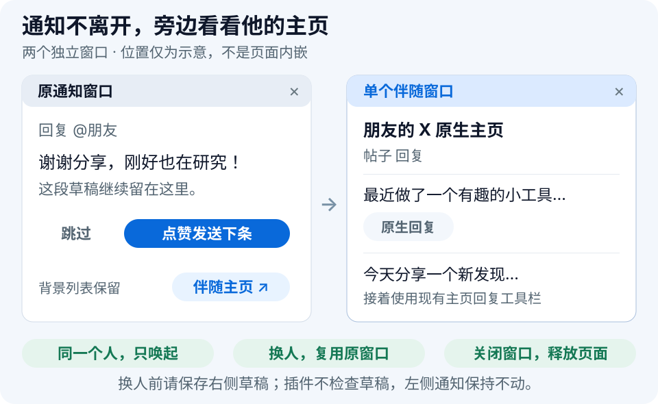
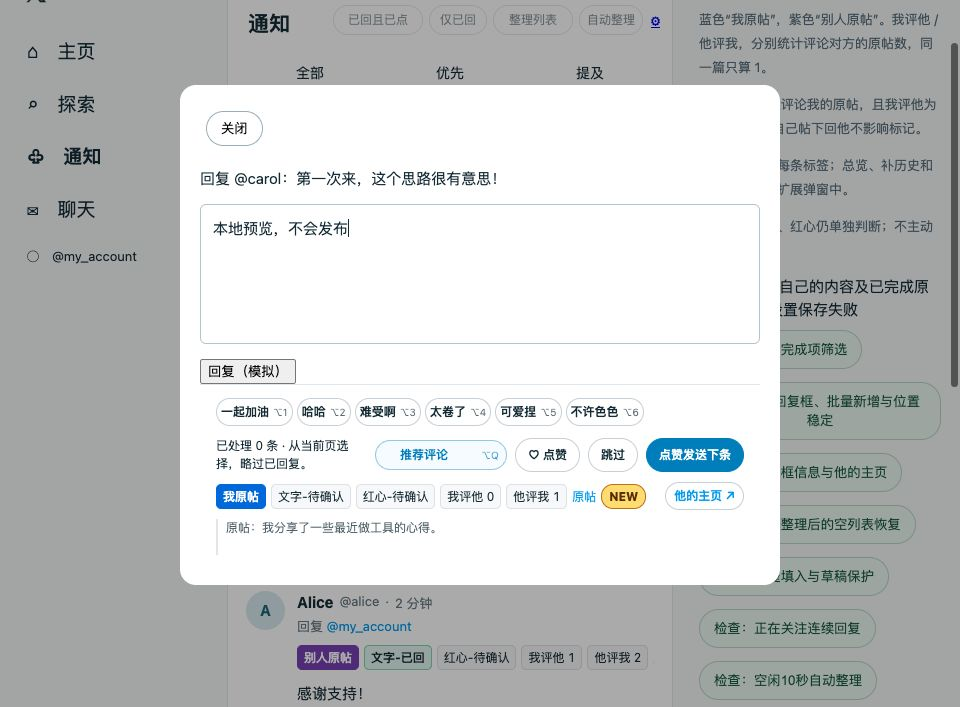
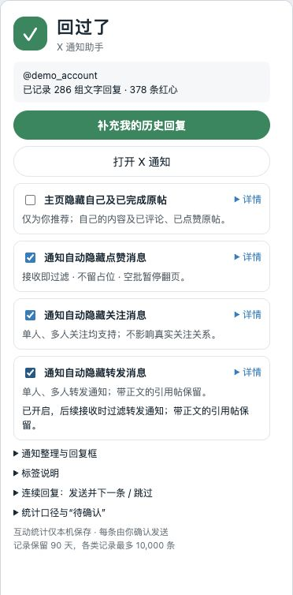

<p align="center">
  
</p>

# 回过了 · X 通知助手

**回过、点过，一眼看清；少点几次，把时间留给聊天。**

一个 Chrome 扩展，帮你看清互动记录、逐条处理回复。写好后可以「点赞发送下条」，也可以打开「伴随主页」看看对方的帖子，原来的通知和草稿留在原处。

**当前版本 0.17.1** · Chrome 111+ · Manifest V3 · 本地存储 · 无运行依赖

[**下载安装包**](dist/x-reply-context-0.17.1.zip) · [快速安装](#快速安装) · [新功能预览](#两个常用动作) · [通知标签](#界面预览) · [筛选开关](#通知筛选) · [更新日志](CHANGELOG.md) · [反馈问题](https://github.com/ChenYilei2016/x-reply-context/issues)

*A Chrome extension for X interaction context, user-confirmed like-and-send, and a reusable native profile window.*

> 每条回复由你决定并确认发送。可单独点赞，也可点击「点赞发送下条」先赞后发。快捷短语仅由你主动点击或按快捷键填入，不自动发送或点赞。网页脚本接入存在平台规范及账号处置风险，使用前请阅读 [使用建议与平台风险](#使用建议与平台风险)。

## 两个常用动作

### 1. 点赞发送下条

**写好回复，点一次，成功后再看下一条。** 已点过的不重复点；不想回复就「跳过」。通知、主页「为你推荐／正在关注」和个人主页「帖子／回复」都支持。

<p align="center">
  
</p>

每条仍由你阅读并确认。下一条只从当前已加载的卡片里选择，插件不主动翻页找帖。[完整操作与异常处理](#连续回复)

### 2. 伴随主页

**在通知里聊着，顺便看看他的帖子。** 点击回复框里的「伴随主页」，在旁边打开一个 X 原生主页窗口，复用已有主页回复工具栏。

<p align="center">
  
</p>

同一个人只唤起，换人直接在原窗口打开新主页，不会越点越多。**换人前请自行保存右侧草稿：插件不会检查或代存右侧编辑内容。** 左边通知和草稿保持原样；关闭伴随窗口后释放该页面。

<details>
<summary>窗口大小、资源开销和升级注意事项</summary>

- 约 800px 宽，靠当前窗口右侧弹出；不自动分屏，也不移动或缩放原窗口。小屏幕可能遮挡左边，可手动移动。
- 它是独立的原生窗口，不是嵌进通知页的 iframe。600px 窄窗口下 X 的回复布局不同，现有工具栏不能直接复用。
- 点击前不加载；打开后 X 自身仍会加载页面、图片和视频，不能视为“只读取 5 篇”的轻量摘要，也不承诺零额外内存。
- 窗口引用在扩展会话内保留，后台工作线程休眠后仍可复用。**重载／更新扩展或重启浏览器前，请先保存并关闭伴随窗口**，避免会话引用清除后留下旧窗口。
- Ctrl／Command／中键等浏览器原生另开链接操作仍由用户选择，不属于伴随窗口管理。右侧 AI 使用原有设置。

[窗口布局与左侧草稿验证（0.17.0）](docs/reviews/0.17.0.md) · [最新行为变更](CHANGELOG.md)

</details>

*以上为功能示意图，不是真实发送截图；两个窗口的位置示意不代表自动分屏。*

## 其他能力，一眼看清

| 能力 | 用途 |
| --- | --- |
| **互动标签与统计** | 原帖归属、文字已回、红心已点、双方评论过几篇及 NEW；记录不足显示待确认。 |
| **通知筛选与整理** | 点赞、关注、纯转发分别过滤；「已回且已点」与「仅已回」互斥选择，自动整理保护阅读区。 |
| **本地原帖摘要** | 通知回复框展示两行已缓存文字，不为补摘要额外请求原帖。 |
| **AI 推荐与快捷短语** | 可选自带 API；手动推荐、改写，六组短语支持 Option/Alt+1～6。 |
| **本地记录与增量保存** | 互动记录留在本机，真实点赞证据优先保留，避免为一次互动重写整份历史。 |

近期还补上了个人主页连续回复，修复红心保留、减少重复扫描和刷新，并移除了双向关注提示。版本细节与历史验证统一见 [CHANGELOG](CHANGELOG.md)。

## 界面预览

**通知里，一行看清是否互动过。**

<p align="center">
  
</p>

<details>
<summary>展开查看实际代码渲染的回复框与筛选设置</summary>

**回复框本地演示（0.16.8 历史截图）。** 当前主页入口已改为「伴随主页」，新操作见上方示意图。

<p align="center">
  
</p>

**三个独立通知过滤开关。**

<p align="center">
  
</p>

转发过滤**默认关闭**，图中为手动开启后的示例。设置说明可点「详情」展开。

</details>

本节截图为扩展实际代码渲染的本地演示，账号、帖子及统计为虚构数据，不代表真实发送验证。

## 快速安装

1. 下载并解压 [0.17.1 安装包](dist/x-reply-context-0.17.1.zip)。也可用 **Code → Download ZIP** 下载源码。
2. 在 Chrome 打开 `chrome://extensions`，开启右上角「开发者模式」。
3. 点击「加载已解压的扩展程序」：安装包选择包含 `manifest.json` 的文件夹；源码选择 **`extension/`**。
4. 完整刷新已打开的 X 页面。建议将「回过了」固定到工具栏，方便调整筛选开关。

安装无需 Node.js、API Key 或额外账号，照常登录 X 即可。

**升级**：先保存草稿并关闭伴随窗口 → 覆盖原扩展目录 → 在扩展管理页重新加载 → 完整刷新所有 X 标签页。只在站内切换主页/通知不够；沿用原目录，避免先卸载导致记录丢失。

<details>
<summary>从 0.15.0 之前的版本升级</summary>

首次启动会将旧记录迁移到 IndexedDB，成功提交后才采用新库，迁移时的旧快照保留。满量模拟数据首次迁移约 2 秒，后续不再重复迁移。新增互动只写入新库，直接降级旧版本不会看到这些新增记录。

</details>

## 通知筛选

| 开关 | 默认 | 在哪里设置 |
| --- | --- | --- |
| 通知自动隐藏点赞消息 | **开启** | 扩展弹窗；包含点赞原帖、喜欢回复及多人聚合点赞。 |
| 通知自动隐藏关注消息 | **开启** | 扩展弹窗；包含单人、多人关注。 |
| 通知自动隐藏转发消息 | **关闭** | 扩展弹窗；包含单人、多人「转发了你的帖子」事件。 |
| 已回且已点 / 仅已回 | **均关闭** | 通知标题栏；互斥选择，再点当前条件关闭。升级保留原开启状态。 |
| 自动整理 | **关闭** | 通知标题栏；配合任一隐藏条件使用。 |
| 主页隐藏自己及已完成原帖 | **关闭** | 扩展弹窗；仅作用于主页「为你推荐」。 |

**开关会记住你的选择。** 点赞、关注、转发在接收时按事件类型过滤，带正文的引用帖、评论和未知事件保留。它们不会先进入列表再逐条折叠，避免堆积隐藏占位。

**改完事件过滤开关后，手动刷新 X 可应用到当前列表。** 设置影响后续接收；关闭开关后刷新也能恢复此前过滤的通知。扩展不自动刷新、不删除通知，也不取消真实互动。

**一批全被过滤就停下。** 点击浮层「继续加载」只放行一批原生请求，本次浏览随后逐批确认，避免为了找评论连续补页。顶部新评论仍可接收；回复框打开时隐藏分页浮层，不打断编辑。

### 已完成互动怎样整理

- **已回且已点**：评论按同一原帖、同一个人判断；两项均有依据才可隐藏，只做一项或待确认时保留。引用帖/原帖卡片要求评论过该原帖，并点赞本帖。
- **仅已回**：按同一原帖、同一个人的文字回复依据隐藏，不要求红心，已点赞的也包含；他人原帖/引用帖按已评论该原帖判断。待确认、自我回复不据此隐藏。与上一条件互斥，已选条件再次点击即关闭。
- **整理列表**：手动一次应用已加载内容的最新完成状态。如果当前已加载帖子全部符合隐藏条件，会显示“本批帖子均已隐藏”和「显示本批」。点击恢复当前卡片，保留筛选条件且不自动再收起；也可再次点击已选条件关闭隐藏。记录不会删除。
- **自动整理**：主动操作后空闲 10 秒，只整理一轮视口下方 600px 之外的完成评论。当前及上方保留，回复框和后台暂停；新数据、补位和页面自行滚动不会续清。

标题栏控件保持固定位置。X 自身的媒体加载、虚拟列表和新消息排序仍可能影响滚动位置。

<details>
<summary>主页「为你推荐」的隐藏规则</summary>

开启后，自己的帖子和回复直接隐藏；其他人的原帖需评论过（含楼中楼）且点赞该原帖本身，才会隐藏。仅评论、仅点赞或待确认时保留。关闭开关可恢复当前卡片，本地互动记录保留。

回复框打开时暂不改变背景折叠状态。此规则不作用于「正在关注」、自定义页签或通知页；这些入口照常记录互动。

</details>

## 连续回复

在通知、主页「为你推荐／正在关注」、个人主页「帖子／回复」点击帖下的小评论按钮，即可使用：

| 操作 | 行为 |
| --- | --- |
| **快捷短语** | 随机选择预设词句和末尾标点，追加到草稿末尾，发送仍由你确认。 |
| **♡ 点赞 / ♥ 已点** | 独立操作当前回复对象的帖子，再点可取消；跳过及 X 原生回复按钮不附带点赞。 |
| **跳过** | 跳过本轮，不记为已回；有未发送内容时尝试保存到 X 草稿，无法确认则暂停。 |
| **点赞发送下条** | 未点赞则点击本帖原生红心，等成功回执和本地保存；随机等待 200～500ms 后发送，发送成功并保存后打开下一条。原生已点状态跳过点赞步骤，不会取消点赞。 |
| **伴随主页 ↗** | 点击后打开单个原生主页窗口；同人只唤起，换人直接导航原窗口，不检查右侧草稿或编辑状态。左侧通知和草稿不变。 |

伴随窗口的使用步骤、资源开销和升级注意事项见 [伴随主页](#2-伴随主页)。

<details>
<summary>六组快捷短语、键位和填入规则</summary>

快捷短语保留原意，只做轻微语气变化：

- **一起加油**：一起加油好兄弟、一起加油鸭、一起加油🦆、一起加油呀等。
- **哈哈**：哈哈、嘿嘿、哈哈哈、嘿嘿嘿，仅这四种普通回应。
- **难受啊**：难受啊、难受呀、难顶呀、难顶啊、太难了、太难了呀。
- **太卷了**：围绕太卷了、别卷了、卷不动了，只变化呀／啊／啦等语气词。
- **可爱捏**、**不许色色**：使用原句，仅随机搭配末尾标点。

原四组完整词句见 [词库记录](docs/reviews/0.15.11.md)。六组按上述顺序对应 **Option/Alt+1～6**，仅回复输入框内生效，长按不会重复填入；按钮也可直接点击。

每次点击末尾随机附加 `...`、`!`、`!!!` 或 `!!`。有原稿时追加并用空格隔开，不替换选中文字；中文输入法组字、改写填入、发送中或多条编辑时暂停快捷填入。

</details>

通知回复框同时显示互动标签和**两行本地原帖摘要**。摘要最多使用已缓存的 200 字符，不额外请求原帖或媒体；缺失时显示「原帖内容暂未缓存」。摘要可能截断或较旧，完整内容可通过已有「原帖」链接查看。

下一条从**当前页已加载的卡片**中选择，不限于下方。评论通知略过同帖里已文字回复过的人，原帖/引用卡片略过已经评论过的原帖；主页同时略过自己的帖子。仅点过红心的仍可展示。新消息不打断当前编辑，切换页签或账号结束本轮，不自动翻页补抓。

点赞结果不明超过 10 秒、记录保存失败或发送结果不明时暂停，不自动重试。200～500ms 是确认点赞后的定时等待，实际总耗时还包含网络、保存和浏览器调度；已点状态也保留这一短等待。等待时编辑、操作回复框内其他控件、关闭、切换账号／列表或页面进入后台，会取消后续自动发送，已成功的点赞保留。

发送失败或结果不明时暂停，不自动重发。手动关闭回复框可退出；X 原有回复按钮仍只发送当前条。个人主页「媒体／转帖」及主页自定义页签暂不启动连续处理，但原生评论仍会记录。

## 内置 AI 回复

**AI API 和自动补全是独立设置。** 自动补全默认关闭；已配置并开启 API 的用户，升级后可直接点击「推荐评论」。 停用原 XReply 后，在扩展弹窗打开「AI 回复设置 · 自带 API」，填写 Base URL、API Key、模型和两套 Prompt，开启并保存。只申请所填模型域名的访问权限，不读取或迁移其他插件保存的 Key。

| 操作 | 行为 |
| --- | --- |
| 推荐评论 / Option+Q（Mac） / Alt+Q（Windows） | 手动请求一条，完成后一次追加到草稿末尾；不自动发送。等待期间继续编辑则不填入。 |
| 打开空回复弹窗 | 默认不请求模型。扩展弹窗中开启「自动 AI 补全」后，才自动生成三条灰字候选；预览不是草稿。 |
| ↑ / ↓ | 空草稿时切换候选；到候选末尾再补一条。 |
| Tab | 采用当前建议的剩余文字，逐字填入。手输前缀与建议一致时仍可采用后半句。 |
| Option+Tab | 改写当前草稿；等待期间若继续编辑，保留新草稿，不应用旧结果。 |
| 跳过、关闭或切换对象 | 取消旧候选请求，停止旧编辑器填入，不把迟到结果写入下一条。 |

生成 Prompt 支持 `${post}`；改写 Prompt 支持 `${post}` 和 `${draft}`。接口为 Base URL 后追加 `/chat/completions`，使用 Bearer Key 和 SSE；默认 Prompt 为独立编写。要保持原有写作风格，可手动粘贴自己的 Prompt；模型输出本身不保证一致。Windows 的 Alt+Tab 由系统占用，本版未另设改写快捷键。

手动推荐／AI 填入／改写期间暂时阻止发送、连续跳过及快捷短语填入，完成后恢复；你仍可手动关闭。已有草稿不会触发自动生成。候选只在当前页面内存中保留，不写入互动历史。仅回复弹窗有可读文字时生成，不抓取图片、整段对话或缺失原帖。

生成、改写和填入时，操作行的 AI 按钮显示转圈及对应状态，下方文字同步提示；结束或失败后恢复。按钮宽度和操作行高度固定，短语较多时仅短语区域横向滚动，AI 状态保持可见。

**性能与请求范围**：不新增全页监听器，复用现有刷新调度；关闭自动补全时打开回复框及重复刷新不会生成；手动推荐每次仅一条，等待时连点不会重复请求。开启自动补全时同一回复框重复刷新也不会重复生成。模型请求独立于记录与分类队列，全扩展最多 3 个在途、12 个等待任务，排队起 25 秒超时；候选最多 32 条，响应读取上限 1 MiB。预览覆盖在编辑器上，不撑高列表；没有新增 X 请求。模型等待耗时取决于你配置的服务。取消客户端请求不保证服务端停止计费。

<details>
<summary>继续使用外部 XReply</summary>

关闭内置 AI 即可保留原有外部 XReply 0.3.2 兼容。请勿同时开启两套 AI；内置模块发现原插件的预览或提示时会暂停生成，但这不能代替手动停用。快捷短语仍为本地随机词库，不调用模型。

</details>

## 标签说明

顺序保持为 **原帖归属 → 文字 → 红心 → 我评他 → 他评我 → 原帖链接 → NEW**，窄处可横向查看。

| 标签 | 含义 |
| --- | --- |
| **我原帖 / 别人原帖** | 蓝色 / 紫色区分整段对话原帖的作者；楼中楼沿用同一原帖。 |
| **文字-已回** | 找到本地回复依据，可点开查看。评论按同帖同人判断，原帖/引用卡片按该原帖下的评论判断。 |
| **红心-已点** | 找到本地点赞依据，可点开查看。评论按同帖同人判断，原帖/引用卡片必须点赞本帖。 |
| **我评他 N / 他评我 M** | 双方各评论过对方的几篇原帖，同篇多次评论只算一篇。 |
| **NEW** | 本地记录中他第一次评论你原帖的那条通知，且「我评他」为 0。 |
| **待确认** | 当前记录不足，不能确认是否操作过。 |

> **「待确认」不等于从未互动，数字 0 和 NEW 也不代表完整历史。** 所有判断只基于本浏览器已读取并保留的记录。

<details>
<summary>统计口径与例子</summary>

文字、红心分别判断，按**当前账号 + 原帖 + 对方**区分。你回过 Alice，不会把同帖的 Bob 标成已回；Alice 换到另一篇原帖，也重新判断。

「我评他 / 他评我」按对方不同原帖去重，包含楼中楼。点赞、在自己或第三方的原帖下回话，不增加对应方向的数字。例如 Alice 在你的原帖留言，你回她后她又回复：显示「文字-已回、我评他 0、他评我 1」；你评论 Alice 的一篇原帖后，才变成「我评他 1、他评我 1」。

NEW 只标首次评论的那一条，后续不重复。点赞、你在自己帖下回她不影响标记；你评论过她的原帖后不再标 NEW。

带正文的引用帖按外层作者的新原帖判断，不借用内嵌被引用帖的互动记录。

</details>

总览中的“组文字回复”与“条红心”不是同一个单位：前者按原帖和对方去重，后者按具体帖子去重并只计已点；历史回复补录也不保证同步补齐历史点赞。

## 数据与隐私

**照常浏览和互动即可积累记录。** 主页、通知、详情及原生小评论按钮共用成功回执链路，无需先进入帖子详情。需要补充旧回复时，可在扩展弹窗点击「补充我的历史回复」，自行浏览自己的回复页；不自动扫描完整历史。

- 互动记录保存在本机 IndexedDB，设置、小型更新通知和迁移时的旧快照保存在 `chrome.storage.local`。伴随窗口的小型引用保存在 `chrome.storage.session`，不包含草稿正文。
- 保存用户 ID / 用户名、帖子关系、点赞状态、互动统计和最多 200 字符的文字片段。各类记录最多 **10,000 条**，保留 **90 天**，到期或淘汰后可能回到待确认。
- 红心保留优先照顾已点赞及真实互动／取消证据，普通未点赞快照优先淘汰；另保留最多 20 个账号级时间保护项。负快照已淘汰后，无法核实的更早未知快照保守忽略，之后正常浏览的新响应可补齐。不会增加 X 查询或由评论推算历史点赞数。
- 不读取请求头、Cookie 或私信接口，不保存未发送草稿；草稿保存使用 X 原生功能，保存在 X 中。
- AI 默认关闭；开启后，当前被回复文本及改写草稿会发往你配置的模型服务。Key 与 Prompt 仅保存在 `chrome.storage.local`，不使用 Chrome 同步；这不等于本机加密保管。
- 无独立服务端或统计上传。卸载扩展会删除该扩展的本地数据；手机和其他浏览器的互动需在本浏览器读取到后才能识别。

| 权限 | 用途 |
| --- | --- |
| `https://x.com/*`、`https://twitter.com/*` | 读取相关页面响应和互动结果，显示标签与回复辅助控件。 |
| `storage` | 保存本地设置及更新通知。 |
| `unlimitedStorage` | 容纳含文字片段的记录；代码仍限制每类数量。 |
| 可选模型域名访问权限 | 声明可选 HTTPS／本机 HTTP 范围，保存 AI 设置时只申请所填域名；只用于模型生成和改写。 |

<details>
<summary>0.15.0 的存储与反馈性能改进</summary>

改为按变化记录保存，不再为一个红心重写整份历史；成功互动去掉 200ms 合批和 250ms 刷新等待。普通时间线更新仍合批，避免高频重绘。

本机满量虚构数据、真实 IndexedDB 测量：单红心计算约 9ms、保存约 14ms；模拟网络成功回执到标签显示约 79ms。冷读取约 205ms，首次迁移约 2.2 秒。这些数字不是实际 X 网络耗时，也不是所有设备的延迟保证。详见 [性能复核与证据](docs/reviews/0.15.0.md)。

</details>

## 兼容性与限制

- 面向桌面 Chrome，最低版本 111；其他浏览器和移动端尚未验证。
- 内置 AI 已通过受控编辑器验证，并在一套用户配置上核对了真实生成、候选采用、改写草稿保护和空草稿跳过；未做真实发送。其他模型端点及完整实发流程仍需确认。[真实验收边界](docs/reviews/0.16.0-live-check.md)。
- 依赖 X 网页接口与页面结构。未知事件保留、证据不足显示待确认，站点更新仍可能导致功能失效。
- 转发通知过滤已通过构造响应验证，真实类型命中仍待开启后的现场确认；[验证边界](docs/reviews/0.15.3.md)如实记录。
- 已回表示曾读取到回复依据，不保证回复仍未被删除；红心依据本机最后观察到的状态。
- 连续回复的成功、失败、跳过、草稿等已做本地模拟；真实页面核对了标签、按钮和布局，完整实发及原生草稿保存仍需正常使用确认。

这是独立开发的浏览器扩展，与 X 官方无关联。

### 使用建议与平台风险

**这是逐条人工操作的效率工具，但不等于获得 X 官方认可。** 与无人值守的自动回复、自动点赞工具相比，每条人工阅读、决定内容和确认发送，可以减少自动批量互动的风险；具体用法仍很重要。

以下是**使用行为的定性比较，不是 X 官方评级或实测封号概率**。表中的“相对较低”不消除各场景共有的技术接入风险。

| 使用场景 | 行为风险比较 | 使用边界 |
| --- | --- | --- |
| 管理自己的通知，逐条阅读，自己写内容，回复已经与你互动的人 | **相对较低** | 保留人工判断，围绕当前话题交流；仍不能保证账号安全。 |
| 在「为你推荐」里高频连续回复陌生人，或配合 AI 批量发送相似内容 | **中到高** | 人工点击不改变批量、重复、无关或未经请求互动的性质。 |
| 批量引流、刷互动、关键词式模板回复 | **高** | 可能直接违反 X 的垃圾互动与平台操纵规则，不属于本工具的使用目的。 |

**技术路径仍是灰色地带和主要风险来源。** X 的[开发者指南](https://docs.x.com/developer-guidelines)允许用户主动点击第三方应用的点赞按钮，但[自动化规则](https://help.x.com/en/rules-and-policies/x-automation)明确限制非 API 网页自动化，违规可能导致永久封禁。本扩展通过网页脚本读取并缓存接口响应、触发原生控件；人工逐次确认、本地存储、不主动补抓历史，均不能视为这些技术路径已获许可。内部 GraphQL 路径也不等于官方开放 API 授权。[服务条款](https://x.com/en/tos)对未授权采集的限制仍需考虑。

**建议谨慎用于个人通知管理，不把它当作增长或批量回复工具。** 阅读上下文后决定是否回复，避免重复模板、无关引流和未经请求的批量接触；不要为了处理更多条目而跳过人工判断。X 的[真实性政策](https://help.x.com/en/rules-and-policies/authenticity)适用于实际互动行为，不会因使用插件或手动点击而豁免。

目前没有本项目的系统性账号安全研究，不能据此声称“正常使用不会封号”、给出安全频率，或保证不存在封号案例。完整的技术接入与数据缓存风险，见 [X 使用规范核查报告](docs/research/x-compliance-0.5.1.md)；其中的技术风险评级与上表的行为风险比较是不同维度。

## 本地开发

需要 **Node.js 22+**，无 npm 依赖，无需执行 `npm install`。

```sh
npm test          # 核心逻辑与请求回执检查
npm run preview  # 虚构数据演示，不连接 X 账号
npm run package  # 生成 dist/ 安装包；需系统 zip / unzip
```

演示入口：`http://127.0.0.1:5818/notifications`、`http://127.0.0.1:5818/home`。

<details>
<summary>代码目录</summary>

```text
extension/
  core.js                  数据归一化、原帖归属与互动统计
  observe.js               页面响应与成功回执观察
  notification-network.js  通知过滤、游标与空批暂停
  storage.js               IndexedDB 增量保存和旧记录迁移
  background.js            消息分派、串行合并与持久化
  companion.js             按需创建、复用和清理伴随窗口
  content.*                通知标签与布局
  continuous.js            连续回复、草稿和原帖摘要
  home-filter.js           主页完成项筛选
  card-filter.js           列表折叠与异步校验
  notification-filter.js   通知整理与空闲调度
  popup.*                  设置、总览与历史入口
tests/                     逻辑、虚构页面和布局检查
scripts/                   预览与打包
assets/readme/             首页展示素材
```

</details>

## 更新记录

查看 [CHANGELOG](CHANGELOG.md) 了解各版本变化；每个版本均链接到对应的验证记录。历史截图和检查结果保留，演示截图不作为真实发送成功的证据。

## 反馈与贡献

欢迎通过 [Issues](https://github.com/ChenYilei2016/x-reply-context/issues) 反馈。请说明 Chrome / 扩展版本、入口、预期和实际结果；截图请遮去账号信息，勿提交 Cookie、访问令牌或完整个人缓存。

修改逻辑后运行 `npm test`，界面改动可使用本地演示页的现有检查。请把 PR 聚焦在具体问题上。

**许可证**：仓库当前尚未设置 `LICENSE`，具体开源许可待维护者确认。
