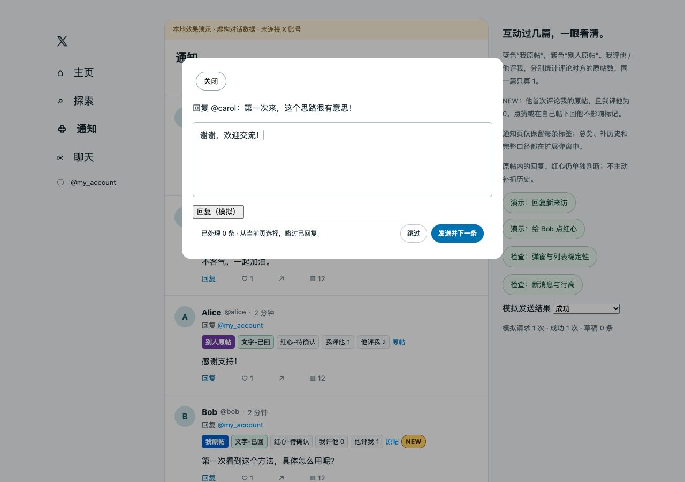

<p align="center">
  
</p>

# 回过了 · X 通知助手

**分清谁的原帖，记住是否回过，把下一次回复留给你决定。**

一个 Chrome 扩展，给 X 通知补上原帖归属、回复与点赞记录、双方互动统计。在通知和「主页 → 为你推荐」支持「发送并下一条」和「跳过」。适合经常逐条交流，又不想反复回复同一段对话的人。

*A Chrome extension with conversation context and interaction history in X notifications, plus reply-next controls for notifications and the For you feed.*

**Chrome 111+** · **Manifest V3** · **本地存储** · **无运行依赖**

[快速安装](#快速安装) · [标签说明](#标签说明) · [连续回复](#连续回复) · [数据与隐私](#数据与隐私) · [本地开发](#本地开发)

<p align="center">
  
</p>

<p align="center"><sub>使用扩展实际标签代码渲染的本地演示；账号与帖子均为虚构。</sub></p>

## 快速安装

1. 下载本仓库源码（**Code → Download ZIP**）并解压，也可以下载并解压 [0.5.0 安装包](dist/x-reply-context-0.5.0.zip)。
2. 在 Chrome 地址栏打开 `chrome://extensions`，启用右上角的「开发者模式」。
3. 点击「加载已解压的扩展程序」：源码选择 **`extension/`**；安装包选择解压后包含 `manifest.json` 的文件夹。
4. 刷新已打开的 X 页面，进入「通知」。建议把「回过了」固定到浏览器工具栏，方便查看总览与统计口径。

安装无需 Node.js、API Key 或额外账号。照常在 X 登录后使用。

**升级**：用新版本覆盖原扩展文件夹，在扩展管理页点击重新加载，再刷新 X 标签页。沿用原安装目录，避免先卸载导致本地记录丢失。

## 标签说明

标签保持一行，顺序为 **原帖归属 → 文字 → 红心 → 我评他 → 他评我 → 原帖链接 → NEW**。窄处可横向查看，整体统计与口径说明收在扩展弹窗里。

| 标签 | 表示什么 |
| --- | --- |
| **我原帖** / **别人原帖** | 蓝色 / 紫色区分整段对话最初的帖子作者；楼中楼沿用同一原帖。 |
| **文字-已回** | 在同一原帖里，找到你回复过这个人的记录。点击可查看依据。 |
| **红心-已点** | 在同一原帖里，找到你给这个人的某条帖子点过红心的记录。点击可查看依据。 |
| **我评他 N** / **他评我 M** | 双方分别评论过对方的几篇原帖，按不同原帖去重。 |
| **NEW** | 这是本地记录中他第一次评论你原帖的那条通知，且「我评他」为 0。 |
| **待确认** | 当前本地记录不足，暂时无法判断。 |

> **「待确认」不等于从未回复或点赞；数字 0 和 NEW 也不代表完整历史。** 所有判断均基于本浏览器已经读取并保留的记录。

### 同一原帖，同一个人

文字与红心分别判断，按 **当前账号 + 原帖 + 对方** 区分。你回过 Alice，不会把同帖里的 Bob 标成已回；Alice 换到另一篇原帖，也会重新判断。

「我评他 / 他评我」统计的是**评论过几篇对方的原帖**：同帖评论 3 次只算 1，包含楼中楼；点赞、在自己或第三方的原帖下回话，不增加对应方向的数字。

例如，Alice 在你的原帖留言，你回她后她又回复：显示「文字-已回、我评他 0、他评我 1」。随后你评论 Alice 的一篇原帖，数字才变成「我评他 1、他评我 1」。

NEW 只标首次评论的那条通知，后续不重复。点赞、你在自己原帖下回复她，不影响这个标记；你评论过她的原帖后，不再标 NEW。

## 连续回复

在通知或「主页 → 为你推荐」列表点击小评论按钮，回复框下方会出现本轮已处理数量和两个新按钮：

| 操作 | 行为 |
| --- | --- |
| **发送并下一条** | 使用 X 原生回复功能发送当前内容；确认成功且保存本地记录后，打开下一条。 |
| **跳过** | 仅跳过本轮，不标记已回；有未发送内容时尝试保存到 X 草稿，无法确认保存则暂停。 |

- 通知自动略过**同一原帖里已文字回复过的人**；主页原帖略过**自己的帖子和已评论过的原帖**，包含在该帖楼中楼的评论。只点过红心的仍展示。当前手动打开的一条由你决定是否再次回复。
- 每次下一步都从**当前页面已加载的卡片**中选择，不限于当前条下方；本轮已发送或跳过的卡片不重复出现，点赞、关注等聚合通知不进入候选。
- **新消息不打断当前编辑**，下一步时如已加载也可以处理。候选移出页面后可改选其他已加载项；不自动翻页补抓，内部每次最多分类 100 条。
- 主页只在「为你推荐」启动连续处理；切换页签或账号会结束本轮。「正在关注」和自定义页签的原生评论仍照常记录。主页不插入逐条标签或额外行高。
- 发送失败或结果不明会停下，不自动重发。
- 手动关闭回复框即可退出。X 原来的回复按钮仍只发送本条；每条是否发送都由你确认。

<details>
<summary>查看连续回复界面</summary>

<p align="center">
  
</p>

演示使用虚构数据。扩展不生成回复内容；如同时使用 XReply，先接受要发送的文字，待逐字填入或改写完成后再发送。当前适配依据为 XReply 0.3.2 的页面标记，其他版本需要重新确认。

</details>

## 记录如何积累

**照常浏览和互动即可。** 支持在主页直接点红心或小评论按钮，也支持在通知里直接回复；成功操作和页面返回的明确状态会被记录，无需先进入帖子详情。

主页、通知、详情和原生回复共用成功回执的保存流程，支持普通与长评论。只有收到匹配账号和回复目标的成功回执，且本地保存完成，才自动进入下一条；「我评他」仍按不同原帖数去重。

需要补充旧回复时，点击扩展图标 →「补充我的历史回复」，在自己的「回复」页向下浏览，然后返回通知。这个步骤可选，不会自动扫描完整历史。手机或其他浏览器上的操作，也要在当前浏览器加载到相关内容后才能识别。

标签区域预留固定高度，打开回复框时保留背景标签并同步更新数字、回复与红心状态，减少插件内容变化引起的列表跳动。成功回复统一保存一次，再进入下一条；X 自身的新消息排序、媒体加载等变化仍可能影响位置。

## 数据与隐私

扩展读取 X 页面已经返回的相关帖子数据，在 `chrome.storage.local` 保存互动关系；不主动补抓历史，不要求额外登录，也没有独立服务端或统计上传。

| 访问范围 / 权限 | 用途 |
| --- | --- |
| `https://x.com/*`、`https://twitter.com/*` | 识别页面返回的帖子与互动结果，在通知和回复框显示提示。 |
| `storage` | 保存本地记录。 |
| `unlimitedStorage` | 容纳含帖子片段的记录；代码仍限制每类记录的数量。 |

本地保存用户 ID / 用户名、帖子关系、点赞状态、互动统计及最多 200 字符的帖子片段。各类记录最多 **10,000 条**，保留 **90 天**（按最后观察时间）。到期或淘汰后，统计可能减少，证据不足时恢复「待确认」。

不读取请求头、Cookie 或私信接口；不保存未发送的草稿内容。回复发送和草稿保存由 X 原生功能完成，草稿保存在 X 中。卸载扩展会删除该扩展的本地数据。

## 兼容性与限制

- 面向桌面 Chrome，最低版本由扩展清单设为 111；其他浏览器与移动端尚未验证。
- 依赖 X 网页的接口与页面结构，站点更新可能导致采集或按钮失效；匹配不到可靠信息时保留「待确认」。
- 已回状态表示曾读取到回复依据，不保证回复尚未被删除；红心以本机最后观察到的状态为准。
- 连续回复的成功、失败、跳过、草稿和新消息场景已做本地模拟；真实页面验证了按钮与布局，完整实发及原生草稿保存链路仍待正常使用确认。

这是独立开发的浏览器扩展，与 X 官方无关联。

### 平台规则与使用边界

X 的[自动化规则](https://help.x.com/en/rules-and-policies/x-automation)禁止自动点赞和非 API 方式的网页自动化；[真实性政策](https://help.x.com/en/rules-and-policies/authenticity)也禁止批量、重复、无关或未经请求的垃圾互动。本扩展目前不自动点赞，每条回复均需手动确认，但连续处理通过网页脚本触发原生控件，仍存在平台规则与账号处置风险，不能视为获得 X 认可或保证合规。请用于逐条阅读后的真实交流，不用于批量引流或刷互动。0.5.0 尚未加入回复框内的点赞快捷按钮。

## 本地开发

需要 **Node.js 22+**。无 npm 依赖，无需执行 `npm install`。

```sh
npm test          # 核心逻辑与请求回执检查
npm run preview  # 本地模拟通知，不连接 X 账号
npm run package  # 生成 dist/ 下的安装包
```

演示入口：`http://127.0.0.1:5818/notifications`、`http://127.0.0.1:5818/home`。打包脚本另外依赖系统提供的 `zip`、`unzip` 命令。

```text
extension/
  core.js          数据归一化、原帖归属与互动统计
  observe.js       观察页面响应与操作回执
  background.js    合并并保存本地记录
  content.*        通知标签与布局
  continuous.js    连续回复与草稿流程
  popup.*          总览、使用说明与历史入口
tests/             逻辑检查、本地演示和布局检查
scripts/           预览与打包
assets/readme/     首页视觉素材
```

0.5.0 增加主页连续评论，覆盖两种主页接口、普通/长评论和 fetch/XHR 的 8 种组合，并检查后续通知的已回状态与原帖数。范围和验证依据见 [0.5.0 开发记录](docs/reviews/0.5.0.md)。既有审查见 [0.4.1 审查记录](docs/reviews/0.4.1.md)，旧版依据保留在 [开发与验证归档](docs/archive/readme-0.4.0-before-redesign.md)。文中的演示截图不作为真实发送成功的证据。

## 反馈与贡献

欢迎通过 [Issues](https://github.com/ChenYilei2016/x-reply-context/issues) 报告失效场景或提出改进。请附上 Chrome / 扩展版本、操作路径、预期与实际结果；截图可使用演示页或遮去账号信息，请勿提交 Cookie、访问令牌或完整个人缓存。

修改逻辑后运行 `npm test`；涉及界面时，可在演示页使用现有的弹窗与行高检查。请把 PR 聚焦在具体问题上。

**许可证**：仓库当前尚未设置 `LICENSE`，具体开源许可待维护者确认。
