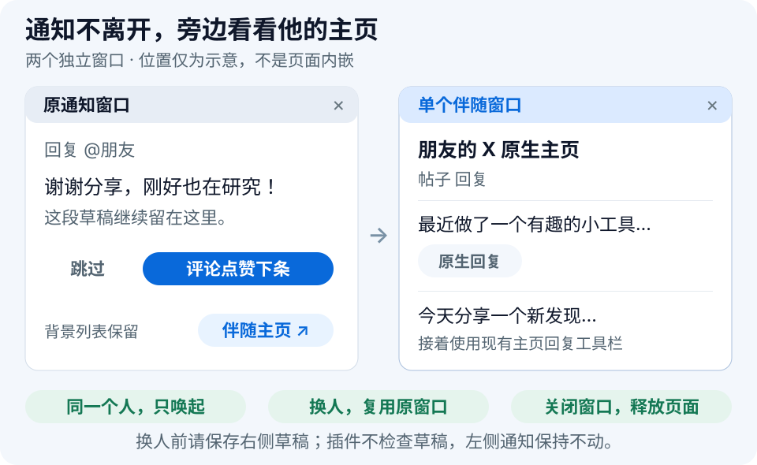
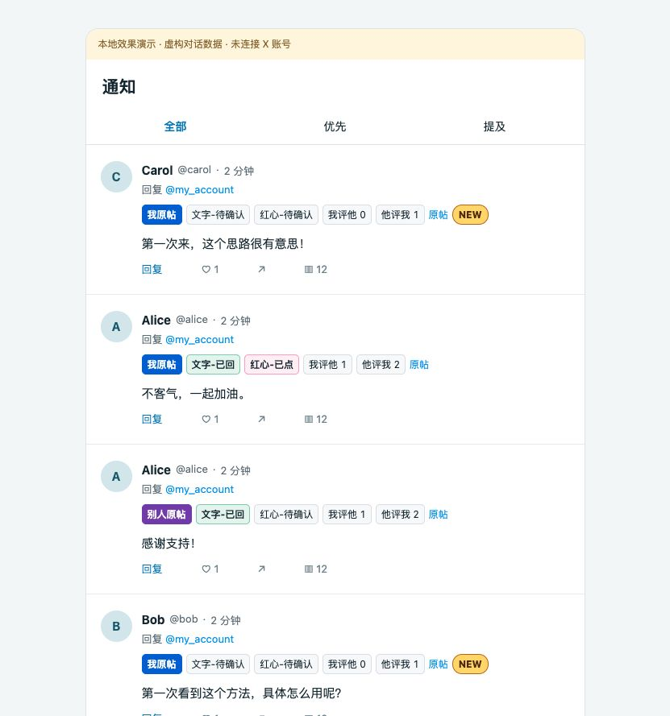
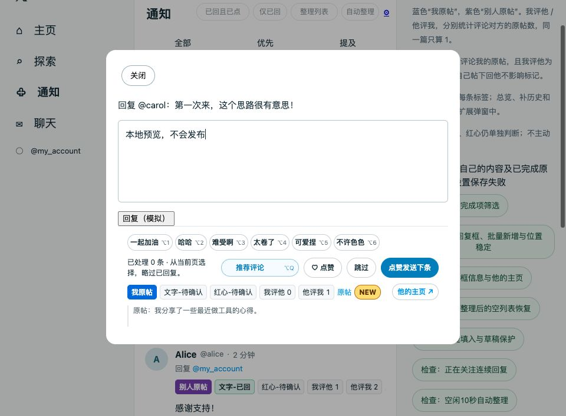
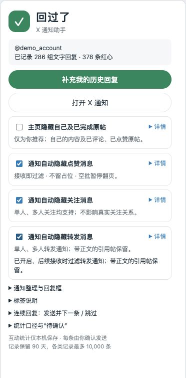

<p align="center">
  
</p>

# 回过了 · X 通知助手

**回过、点过，一眼看清；少点几次，把时间留给聊天。**

一个 Chrome 扩展，帮你看清互动记录、逐条处理回复。写好后可以「评论点赞下条」，也可以打开「伴随主页」看看对方的帖子，原来的通知和草稿留在原处。

**当前版本 0.24.6** · Chrome 111+ · Manifest V3 · 本地存储 · 无运行依赖

[**下载安装包**](dist/x-reply-context-0.24.6.zip) · [快速安装](#快速安装) · [新功能预览](#两个常用动作) · [帖子视频下载](#帖子视频下载) · [通知标签](#界面预览) · [筛选开关](#通知筛选) · [更新日志](CHANGELOG.md) · [反馈问题](https://github.com/ChenYilei2016/x-reply-context/issues)

*A Chrome extension for X interaction context, user-confirmed reply-then-like, and a reusable native profile window.*

> 默认由你决定并确认发送；开启可选定时触发并点击“开始本轮”后，会自动发送已填好的草稿。可单独点赞，也可点击「评论点赞下条」先发后赞。快捷短语仅由你主动点击或按快捷键填入，不自动发送或点赞。网页脚本接入存在平台规范及账号处置风险，使用前请阅读 [使用建议与平台风险](#使用建议与平台风险)。

## 两个常用动作

### 1. 评论点赞下条

**写好回复，点击按钮或按 Option+Enter（Windows：Alt+Enter），成功后再看下一条。** 已点过的不重复点；不想回复就「跳过」。通知、主页「为你推荐／正在关注」、个人主页「帖子／回复」和搜索「热门／最新」（含点击 `#标签` 进入）都支持。

<p align="center">
  
</p>

快捷键仅在回复输入框内发送，沿用按钮禁用状态。发送或切换到下一条期间的按键会被拦截，长按和输入法组字也不会触发发送。

手动模式下，每条仍由你阅读并确认；可选定时模式见下方说明。下一条只从当前已加载的卡片里选择，插件不主动翻页找帖。[完整操作与异常处理](#连续回复)

### 2. 伴随主页

**在通知里聊着，顺便看看他的帖子。** 点击回复框里的「伴随主页」，在旁边打开一个 X 原生主页窗口，复用已有主页回复工具栏。

<p align="center">
  
</p>

同一个人只唤起，换人直接在原窗口打开新主页，不会越点越多。**换人前请自行保存右侧草稿：插件不会检查或代存右侧编辑内容。** 左边通知和草稿保持原样；关闭伴随窗口后释放该页面。

<details>
<summary>窗口大小、资源开销和升级注意事项</summary>

- 约 800px 宽，靠当前窗口右侧弹出；不自动分屏，也不移动或缩放原窗口。小屏幕可能遮挡左边，可手动移动。
- 它是独立的原生窗口，不是嵌进通知页的 iframe。600px 窄窗口下 X 的回复布局不同，现有工具栏不能直接复用。
- 点击前不加载；打开后 X 自身仍会加载页面、图片和视频，不能视为“只读取 5 篇”的轻量摘要，也不承诺零额外内存。
- 窗口引用在扩展会话内保留，后台工作线程休眠后仍可复用。**重载／更新扩展或重启浏览器前，请先保存并关闭伴随窗口**，避免会话引用清除后留下旧窗口。
- Ctrl／Command／中键等浏览器原生另开链接操作仍由用户选择，不属于伴随窗口管理。右侧 AI 使用原有设置。

[窗口布局与左侧草稿验证（0.17.0）](docs/reviews/0.17.0.md) · [最新行为变更](CHANGELOG.md)

</details>

*以上为功能示意图，不是真实发送截图；两个窗口的位置示意不代表自动分屏。*

## 其他能力，一眼看清

| 能力 | 用途 |
| --- | --- |
| **互动标签与统计** | 原帖归属、文字已回、红心已点、双方评论过几篇及 NEW；记录不足显示待确认。 |
| **关注数与粉丝数** | 帖子卡片和回复框在互动统计旁显示。个人主页的「正在关注／关注者／认证关注者」列表在用户名旁显示。标签缩写为「关」「粉」，悬停可看完整数字。复用页面响应，缺字段省略。 |
| **通知筛选与整理** | 点赞、关注、纯转发分别过滤；「已回且已点」与「仅已回」互斥选择，自动整理保护阅读区。 |
| **本地原帖摘要** | 通知回复框展示两行已缓存文字，不为补摘要额外请求原帖。 |
| **AI 推荐与快捷短语** | 可选自带 API；手动推荐、改写，六组短语支持 Option/Alt+1～6。 |
| **本地记录与增量保存** | 互动记录留在本机，真实点赞证据优先保留，避免为一次互动重写整份历史。 |

**0.17.4 补齐标签搜索**：点击帖子中的 `#标签` 进入的热门／最新搜索，也能使用同一套回复工具栏和底部互动数。更换标签或页签停止旧会话，不增加 X 请求。[验证记录](docs/reviews/0.17.4.md)。

**0.17.3 回复框底部互动数**：通知、首页、个人主页、搜索以及伴随窗口中的已有回复工具栏，最底部统一显示「我评他／他评我」。直接复用本地统计，不额外请求；缺少数据时固定占位显示待确认。[验证记录](docs/reviews/0.17.3.md)。

**0.17.2 补上搜索入口**：搜索「热门／最新」的小评论按钮也可使用快捷短语、AI 推荐、点赞、跳过、下一条和伴随主页；更换搜索词、筛选或页签时结束旧会话，不主动翻页。[验证记录](docs/reviews/0.17.2.md)。

近期还补上了个人主页连续回复，修复红心保留、减少重复扫描和刷新，并移除了双向关注提示。版本细节与历史验证统一见 [CHANGELOG](CHANGELOG.md)。

## 界面预览

**通知里，一行看清是否互动过。**

<p align="center">
  
</p>

<details>
<summary>展开查看实际代码渲染的回复框与筛选设置</summary>

**回复框本地演示（0.16.8 历史截图）。** 当前主页入口已改为「伴随主页」，新操作见上方示意图。

<p align="center">
  
</p>

**三个独立通知过滤开关。**

<p align="center">
  
</p>

转发过滤**默认关闭**，图中为手动开启后的示例。设置说明可点「详情」展开。

</details>

本节截图为扩展实际代码渲染的本地演示，账号、帖子及统计为虚构数据，不代表真实发送验证。

## 快速安装

1. 下载并解压 [0.24.6 安装包](dist/x-reply-context-0.24.6.zip)。也可用 **Code → Download ZIP** 下载源码。
2. 在 Chrome 打开 `chrome://extensions`，开启右上角「开发者模式」。
3. 点击「加载已解压的扩展程序」：安装包选择包含 `manifest.json` 的文件夹；源码选择 **`extension/`**。
4. 完整刷新已打开的 X 页面。建议将「回过了」固定到工具栏，方便调整筛选开关。

安装无需 Node.js、API Key 或额外账号，照常登录 X 即可。

**升级**：先保存草稿并关闭伴随窗口 → 覆盖原扩展目录 → 在扩展管理页重新加载 → 完整刷新所有 X 标签页。只在站内切换主页/通知不够；沿用原目录，避免先卸载导致记录丢失。

<details>
<summary>从 0.15.0 之前的版本升级</summary>

0.21.0 首次读取会先在独立备份存储保留旧 IndexedDB 记录及可用的旧 local 快照，再迁移互动事实和人物汇总；备份失败不升级，迁移失败保留旧数据供重试。迁移只执行一次，满量模拟约4秒。扩展弹窗可打开「导出升级前备份／统计说明」下载本机 JSON。数据库已升级，旧版扩展不能直接读取新版库，请保留备份并避免直接降级。

</details>

## 帖子视频下载

打开「回过了」弹窗，在「帖子视频下载」粘贴 X 或 Twitter 的帖子链接。当前在帖子详情页时会自动填入链接。点「下载 MP4」，Chrome 会保存为 `X-帖子ID.mp4`。

优先复用当前标签已加载的视频，必要时在临时标签正常打开一次原帖。多段视频时下载第一段可用视频的最高码率 MP4。引用帖中的视频请使用视频原帖的链接。

## 通知筛选

| 开关 | 默认 | 在哪里设置 |
| --- | --- | --- |
| 通知自动隐藏点赞消息 | **开启** | 扩展弹窗；包含点赞原帖、喜欢回复及多人聚合点赞。 |
| 通知自动隐藏关注消息 | **开启** | 扩展弹窗；包含单人、多人关注。 |
| 通知自动隐藏转发消息 | **关闭** | 扩展弹窗；包含单人、多人「转发了你的帖子」事件。 |
| 已回且已点 / 仅已回 | **均关闭** | 通知标题栏；互斥选择，再点当前条件关闭。升级保留原开启状态。 |
| 自动整理 | **关闭** | 通知标题栏；配合任一隐藏条件使用。 |
| 主页隐藏自己及已完成原帖 | **关闭** | 扩展弹窗；仅作用于主页「为你推荐」。 |

**开关会记住你的选择。** 点赞、关注、转发在接收时按事件类型过滤，带正文的引用帖、评论和未知事件保留。它们不会先进入列表再逐条折叠，避免堆积隐藏占位。

**改完事件过滤开关后，手动刷新 X 可应用到当前列表。** 设置影响后续接收；关闭开关后刷新也能恢复此前过滤的通知。扩展不自动刷新、不删除通知，也不取消真实互动。

**一批全被过滤就停下。** 点击浮层「继续加载」只放行一批原生请求，本次浏览随后逐批确认，避免为了找评论连续补页。顶部新评论仍可接收；回复框打开时隐藏分页浮层，不打断编辑。

### 已完成互动怎样整理

- **已回且已点**：评论按同一原帖、同一个人判断；两项均有依据才可隐藏，只做一项或待确认时保留。引用帖/原帖卡片要求评论过该原帖，并点赞本帖。
- **仅已回**：按同一原帖、同一个人的文字回复依据隐藏，不要求红心，已点赞的也包含；他人原帖/引用帖按已评论该原帖判断。待确认、自我回复不据此隐藏。与上一条件互斥，已选条件再次点击即关闭。
- **整理列表**：手动一次应用已加载内容的最新完成状态。如果当前已加载帖子全部符合隐藏条件，会显示“本批帖子均已隐藏”和「显示本批」。点击恢复当前卡片，保留筛选条件且不自动再收起；也可再次点击已选条件关闭隐藏。记录不会删除。
- **自动整理**：主动操作后空闲 10 秒，只整理一轮视口下方 600px 之外的完成评论。当前及上方保留，回复框和后台暂停；新数据、补位和页面自行滚动不会续清。

标题栏控件保持固定位置。X 自身的媒体加载、虚拟列表和新消息排序仍可能影响滚动位置。

<details>
<summary>主页「为你推荐」的隐藏规则</summary>

开启后，自己的帖子和回复直接隐藏；其他人的原帖需评论过（含楼中楼）且点赞该原帖本身，才会隐藏。仅评论、仅点赞或待确认时保留。关闭开关可恢复当前卡片，本地互动记录保留。

回复框打开时暂不改变背景折叠状态。此规则不作用于「正在关注」、自定义页签或通知页；这些入口照常记录互动。

</details>

## 连续回复

在通知、主页「为你推荐／正在关注」、个人主页「帖子／回复」、搜索「热门／最新」点击帖下的小评论按钮，即可使用：

| 操作 | 行为 |
| --- | --- |
| **快捷短语** | 随机选择预设词句和末尾标点，追加到草稿末尾，发送仍由你确认。 |
| **♡ 点赞 / ♥ 已点** | 独立操作当前回复对象的帖子，再点可取消；跳过及 X 原生回复按钮不附带点赞。 |
| **跳过** | 跳过本轮，不记为已回；有未发送内容时尝试保存到 X 草稿，无法确认则暂停。 |
| **评论点赞下条 / Option+Enter** | 先发送评论并等待成功回执、本地保存；再随机等待 300～750ms 点赞，点赞确认保存后打开下一条。已点过则跳过点赞，不取消；点赞异常时保留评论成功状态，不重发。 |
| **伴随主页 ↗** | 点击后打开单个原生主页窗口；同人只唤起，换人直接导航原窗口，不检查右侧草稿或编辑状态。左侧通知和草稿不变。 |

伴随窗口的使用步骤、资源开销和升级注意事项见 [伴随主页](#2-伴随主页)。

<details>
<summary>六组快捷短语、键位和填入规则</summary>

快捷短语保留原意，只做轻微语气变化：

- **一起加油**：一起加油好兄弟、一起加油鸭、一起加油🦆、一起加油呀等。
- **哈哈**：哈哈、嘿嘿、哈哈哈、嘿嘿嘿，仅这四种普通回应。
- **难受啊**：难受啊、难受呀、难顶呀、难顶啊、太难了、太难了呀。
- **太卷了**：围绕太卷了、别卷了、卷不动了，只变化呀／啊／啦等语气词。
- **可爱捏**、**不许色色**：使用原句，仅随机搭配末尾标点。

原四组完整词句见 [词库记录](docs/reviews/0.15.11.md)。六组按上述顺序对应 **Option/Alt+1～6**，仅回复输入框内生效，长按不会重复填入；按钮也可直接点击。

每次点击末尾随机附加 `...`、`!`、`!!!` 或 `!!`。有原稿时追加并用空格隔开，不替换选中文字；中文输入法组字、改写填入、发送中或多条编辑时暂停快捷填入。

</details>

各入口的回复工具栏底部显示 **我评他 N／他评我 M**，统计双方各评论过对方的不同原帖数，同篇多次只计 1。当前帖子未缓存时，可从卡片的时间链接识别作者并读取已有的本地互动汇总。记录不足时显示「待确认」。

通知回复框另外显示原帖归属、文字／红心状态、NEW 和**两行本地原帖摘要**，双向计数移至底部，不重复显示。摘要最多使用已缓存的 200 字符，不额外请求原帖或媒体；缺失时显示「原帖内容暂未缓存」。摘要可能截断或较旧，完整内容可通过已有「原帖」链接查看。

「评论点赞下条」和「跳过」从**当前帖往下**选择已加载的卡片。下方没有合适的帖子时结束本轮。评论通知略过同帖里已文字回复过的人，原帖/引用卡片略过已经评论过的原帖；主页同时略过自己的帖子。仅点过红心的仍可展示。新消息不打断当前编辑，切换页签或账号结束本轮，不自动翻页补抓。

点击帖子或关注列表中作者信息处的 **⊘**，可把这位作者加入当前账号的本地跳过名单。标记亮起后，自动下一条和自动换批都会绕开他的帖子。再次点击或在扩展弹窗的「自动跳过名单」里选择「恢复」即可取消。名单只用于扩展自动选帖。

主页、搜索和个人主页把 **⊘** 和「我评他 N · 他评我 M」放在同一行。有现成的关／粉数据时，帖子卡片和回复框也会在互动统计旁显示。有正文的帖子把这行放在正文上方。互动次数复用本地记录，`—` 表示记录不足，悬停可查看统计口径。

点赞结果不明超过 10 秒、记录保存失败或发送结果不明时暂停，不自动重试。300～750ms 是评论确认并保存后、点赞前的等待，实际耗时还包含网络、保存和浏览器调度；已点状态也保留这一短等待。评论失败或未确认时不点赞；评论已成功而点赞失败时提示已发出，不重发评论。等待期间编辑、操作其他控件、关闭、切换账号／列表或页面进入后台，会停止后续点赞与跳转；已成功的操作保留。

发送失败或结果不明时暂停，不自动重发。手动关闭回复框可退出；X 原有回复按钮仍只发送当前条。搜索「用户／媒体／列表」、个人主页「媒体／转帖」及主页自定义页签暂不启动连续处理，但原生评论仍会记录。

评论已确认并保存后，如果原卡片移出列表、点赞按钮缺失或禁用，会保留原停顿、略过点赞并打开下一条已加载的可处理卡片。不重复发送、不补造点赞记录；若有待确认点赞、红字警告、草稿变化或后台状态，仍暂停。没有候选时结束，不主动分页。卡片不可见不等于确认原帖已删除。

## 可选：定时触发评论点赞下条

仅支持「主页 → 为你推荐」，**默认关闭**。在扩展图标弹窗保存配置，再在回复框点击「开始本轮」。这会实际触发「评论点赞下条」，不是只填字；它复用原按钮流程，不向操作系统模拟键盘。

| 配置 | 默认值 | 可设置范围 |
| --- | --- | --- |
| 每次随机间隔 | 3～10秒 | 3～3600秒，最小≤最大 |
| 本轮最多触发 | 500次 | 1～500次 |
| 本轮最长时长 | 60分钟 | 1～240分钟 |

次数按尝试触发发送计数，失败不会自动重试。次数或时长任一先到，就不再触发新的发送；已触发的本条仍沿用原有回执、点赞和暂停保护。时间从点击开始本轮起算，等待草稿也计入总时长。

可选「页面可见时，失焦仍继续」，默认关闭，在扩展弹窗的定时配置中保存。开启后仅正在运行的定时本轮及其换批续接忽略窗口失焦；浏览器判定页面隐藏、切换标签或最小化仍暂停，返回可见不会自动恢复。可见性以浏览器报告为准：并排工作通常可用，完全遮挡可能被判定隐藏；浮窗固定一行显示「页面可见／页面隐藏 · 有焦点／已失焦」，由可见性和焦点事件更新，不轮询、不撑动列表。不激活窗口或抢系统焦点。修改选项会结束当前轮次，需重新开始。当前本轮已允许可见失焦时，AI 自动填入不再要求新回复框先获得输入焦点；只作用于已核对的当前目标。页面获焦且用户在其他控件时仍不抢输入焦点，草稿变化或隐藏则停止写入。自动生成失败或填入受阻会提示原因并结束定时本轮，不自动重试。

定时运行中会阻止电脑因闲置进入系统睡眠，屏幕仍可熄灭。暂停、关闭标签页或收尾完成时释放。换批时各文档独立持有短时防休眠记录，旧页面迟到续期或释放不会覆盖新页面；关闭标签清理该标签的全部文档记录。失联约 20 秒后正常清理，若扩展后台重启，则由 Chrome 定时任务补做清理，实际触发时间由浏览器决定。仅开启配置、普通浏览和手动连续回复时使用系统原有电源设置。[Chrome 电源权限说明](https://developer.chrome.com/docs/extensions/reference/api/power)

定时发送仅支持纯文字草稿。倒计时中加入附件或投票会结束本轮，可用 X 原生回复按钮处理。达到次数或时长上限后，已经发出的最后一条最多保留 60 秒收尾时间。暂停时，迟到的候选查询结果不会滚动列表或打开新回复框。

- 草稿就绪、AI填入结束且原生发送按钮可用后，才随机安排一次等待；没有草稿时不发送、不自行请求AI。若另行启用了现有自动AI草稿，仍按那个开关工作。
- 同一目标不会连续触发；回复成功、记录保存并进入下一条后，待新草稿就绪再安排下一次。无候选时停止，不主动分页。
- 手动「暂停本轮」、切到后台或未开启失焦继续时窗口失焦，会保留已用次数与原截止时间，需手动点「继续本轮」，重新随机等待后才触发。暂停不延长时长、不运行计时器，不补发错过的时段。红字警告、失败/结果不明、手动发送/跳过、关闭回复框、换页面/账号或修改定时配置仍结束本轮，不能直接继续。
- 暂停也会取消当前 AI 生成/填入，操作区显示「AI 自动填入已暂停」，手动推荐仍可用。明确点击「继续本轮」时，如果开启了为你推荐自动填入、草稿为空，就按当前已确认的回复对象和已保存 AI 设置重新准备一次；X 重建输入框也不依赖旧节点的暂停记录。只有实际启动准备才恢复计时，未开启自动填入或无法启动则明确保持暂停；已有手写内容不覆盖，不因普通刷新调度自行生成。未完成的 AI 半成品需先核对并编辑，或清空后再继续，不会直接进入发送倒计时。
- 开关保存不等于启动，新一轮需点击「开始本轮」。仅插件主动的“自动换一批”可继续同一轮，继承已用次数与原截止时间；恢复后重新等待至少3秒，不补发错过的时段。手动刷新、历史返回或普通导航不恢复。暂停会取消本条尚未执行的后续点赞/跳转，已发出的评论无法撤回。发送中暂停时先等结果确认；成功后手动点击「下一条」，在新回复框「继续本轮」，不会重发旧评论或补点旧红心。暂停只属于当前页面与连续回复会话，手动重新打开其他帖子不继承。点赞请求已经发出但未确认，或换批登记/刷新衔接途中暂停，会终止本轮，需核对后重新开始。
- 配置留在本机，正常执行进度在页面内存中；仅自动换批时存入同标签页的一次性扩展会话记录（账号、次数、期限与配置，不含草稿或Key），消费后删除。最多一个执行计时器，不按秒轮询或重写DOM，不增加历史接口请求。显示的是本次计划等待时长，不是每秒刷新的倒计时。

页面固定标记独立于回复框：绿色表示运行，黄色表示已暂停或刷新衔接，灰色表示未开始或已停止；显示当前动作、已触发次数、截止时间，运行中提供暂停按钮，暂停后原位显示继续按钮。回复框关闭后标记仍在，不挤动列表。已有自定义间隔保留，新配置默认3～10秒。配置上下限按整数秒填写，实际每次按毫秒随机（例如3.864秒），并显示本次等待时间；同一草稿等待期间不重新抽样。

自动换批恢复会再次检查前台、账号、设置和剩余预算；无候选、超时、设置变化或中途停止均丢弃续接记录。停止与迟到返回按换批编号关联，旧取消不影响新一轮，取消消息不反向循环。[专项审阅与验证](docs/reviews/0.20.1.md)

## 可选：评论后随机跳过点赞

扩展图标弹窗新增「评论后50%概率跳过点赞」，**默认关闭**。开启后，每次触发「评论点赞下条」（按钮、Option/Alt+Enter 或已开启的定时触发）时独立决定一次：50%不点赞，另外50%沿用原点赞流程；不是交替执行，也不保证每批恰好一半。

两条分支都先等待评论成功并保存，再停顿 **300～750ms**。不点赞时直接进入下一条；点赞时等成功回执和保存后进入下一条。已点赞的不会取消。跳过点赞不会补造红心记录，评论记录及换批计数照常处理；“已回且已点”的筛选仍要求实际点赞证据。

开关变化从下一次操作生效，不改变已开始这一条的选择。独立点赞、原生回复和“跳过”保持原行为；切换后台、编辑草稿、关闭或遇到异常时仍停止后续操作。只复用原有停顿，不增加 X 请求、轮询或额外存储扫描。

## 异常提示与暂停

评论、长评论、点赞、取消点赞的已监听接口出现 HTTP 错误、业务错误、警告、网络中断或无法确认的回执时，顶部显示**红色持久提示**。包含 X 返回的错误摘要、HTTP 状态、错误码和 Retry-After（若有）；不会自动消失或按倒计时恢复。

- 同时暂停当前页连续回复、后续点赞、下一条和自动换批；在窗口捕获阶段拦截发送/点赞按钮、发送组合键，以及非编辑区域的原生 L/R/T/N 互动键（keydown/keypress/keyup）。草稿内普通文字仍可编辑。
- AI 生成、改写和逐字填入共用暂停状态：取消在途任务、丢弃迟到结果，不响应推荐/改写/候选快捷键，也不在暂停期间重新打开的空框里自动生成。解除本身不会重启旧任务；重新主动打开回复框后按原配置工作。
- 账号信息暂时读取为空时保持暂停；确认切换到另一个账号后才释放旧账号在本页的保护。
- 提示固定覆盖，不挤动列表或回复框；草稿保留。成功回执仍按原规则保存；成功同时带警告也暂停，不把已成功操作重发。
- 点击「我已查看，解除暂停」只解除本页拦截，不重试、不点赞、不发送。核对完结果后，重新打开回复框可启动连续回复。
- 只读取现有请求，不增加 X 请求、不轮询。错误 JSON 读取最多 64 KiB，显示摘要最多 600 字符，相同提示合并。

此保护限定当前页面、当前账号；不是跨标签页封锁，完整刷新会结束本页暂停。只覆盖已监听的 `CreateTweet`、`CreateNoteTweet`、`FavoriteTweet`、`UnfavoriteTweet` 响应，不扫描帖子正文来猜警告，也不保证识别 X 将来更换的接口或仅显示在页面上的独立警告。已发出的请求无法撤回；收到限流或账号警告后，应先处理 X 的提示。

## 自动换一批（可选）

仅在「为你推荐」回复框最下面配置，**默认关闭，区间默认 10～20 条**，可设 1～1000 的整数区间。每轮随机选定一个目标，旁边显示进度，例如 `换批 6/14`。

只计算通过「评论点赞下条」或 Option/Alt+Enter 成功发送并保存的评论，每条成功回复只计一次；跳过、失败及单独点击 X 原生回复不计。达到目标后，等本条点赞流程结束、回复框关闭，**当前标签页进入并刷新「主页 → 为你推荐」**，从已加载、可确认且未回复的帖子中打开一个回复框。手动模式只打开回复框；已启动的定时轮会按同一轮剩余预算继续。若已启用 AI 自动补全，仍按原设置生成候选。

- 有草稿、弹窗、正在编辑或页面在后台时暂停刷新，并显示具体原因；后台登记失败单独显示错误，不再统称“确认没有草稿”。点赞异常先暂停，核对并手动继续后才进入换批判断。
- 没有合适帖子、账号变化、读取失败或 15 秒内未准备好就停下，不继续翻页或循环刷新。
- 开关旁立即显示「保存中…」，失败恢复原值；旧保存回调不覆盖跨窗口的新设置。「换批：已关闭」与下一行「定时回复：已关闭」分别对应两个独立功能。
- 开关和区间是浏览器内共享设置，进度只属于当前标签页和账号；修改设置、切换账号、完整手动刷新会重新计数。
- 通知页不显示此配置、不计数、不触发换批。刷新会产生 X 正常页面加载请求，插件不额外请求历史。

[初版验证记录](docs/reviews/0.18.0.md)（0.18.1 起移除通知入口）

## 内置 AI 回复

支持保存 **最多10组 API 配置**，每组独立保存名称、Base URL、API Key 和模型，两套 Prompt 共用。在「AI 回复设置」中选择配置，点击「保存并使用此配置」切换；只有保存成功才生效，切换时取消旧配置的在途生成和候选，已写入的草稿保留。不自动轮换 Key、不失败转用其他 API。

- 旧单组配置读取时显示为「原有配置」，启用状态、Key、模型与 Prompt 保留；第一次保存后转换为多组结构。未保存前不改写原存储。
- 内置「OpenAI / ChatGPT」预设：`https://api.openai.com/v1` + `gpt-6-luna`，Key 留空，需填入自己的 OpenAI API Key；不读取 ChatGPT 网页登录状态。[官方模型说明](https://developers.openai.com/api/docs/models/gpt-6-luna) · [官方接口说明](https://developers.openai.com/api/reference/resources/chat/subresources/completions/methods/create)
- OpenAI 官方地址可按组选择「跟随项目默认／标准／快速（费用更高）」。默认跟随项目，省略 `service_tier`；标准发送 `default`，快速发送 `fast`。第三方地址不显示此选项，也不发送该参数。保存后生效，实际处理等级由 OpenAI 决定；不自动回退或重试。[快速模式官方说明](https://developers.openai.com/api/docs/guides/fast-mode)
- `gpt-6-luna` 只作为新建预设默认值，已有组的模型、Key 和 Prompt 不覆盖；已有 OpenAI 组如需改用 Luna，可把模型字段改为 `gpt-6-luna` 后保存。处理模式与推理强度、逐字填入间隔分别设置。
- OpenAI 官方地址新增「推理强度」：跟随模型默认（省略参数），或 `none / minimal / low / medium / high / xhigh / max`。按 API 组独立保存，生成和改写都传 `reasoning_effort`；第三方地址不发送。各模型支持档位不同，不支持时显示请求错误，不自动降级或重试。[官方参数说明](https://developers.openai.com/api/reference/resources/chat/subresources/completions/methods/create)
- 可新增、重命名、删除配置。列表来回切换保留本页未保存的编辑；删除和切换均在保存后生效，关闭有修改的设置页会提示。保存失败保留原生效配置。
- 只为启用的当前配置申请模型域名授权；其他组只保存在本机。网页内容脚本拿不到整组配置或 Key。
- 官方 OpenAI 请求使用模型默认温度，不强制传入可能不兼容的 `temperature`；其他兼容接口保留现有参数。没有增加 X 请求、轮询或自动重试。


**AI API、灰字补全和自动填入分别设置。** 两种自动功能默认关闭。已配置并开启 API 的用户可直接点击「推荐评论」。停用原 XReply 后，在扩展弹窗打开「AI 回复设置」，填写 Base URL、API Key、模型和两套 Prompt，开启并保存。只申请所填模型域名的访问权限，不读取或迁移其他插件保存的 Key。

开启弹窗里的「为你推荐 · 自动填入 AI 草稿」，在该列表打开空回复框时只生成一条，并按设置逐字填入，优先于灰字候选。填入时可以手动编辑以停止后续填入。核对后，在输入框按现有的 **Option+Enter**（Windows 为 Alt+Enter）。长按、生成中和间隔不足 500 毫秒的连按均不会排队发送。

| 操作 | 行为 |
| --- | --- |
| 推荐评论 / Option+Q（Mac） / Alt+Q（Windows） | 手动请求一条，完成后一次追加到草稿末尾；不自动发送。等待期间继续编辑则不填入。 |
| 打开空回复弹窗 | 默认不请求模型。开启「自动 AI 补全」可生成三条灰字候选；开启「为你推荐 · 自动填入 AI 草稿」时，该列表改为生成一条直接填入。 |
| ↑ / ↓ | 空草稿时切换候选；到候选末尾再补一条。 |
| Tab | 采用当前建议的剩余文字，按设置逐字填入（默认每字额外等待35～100ms，另有编辑器同步时间）。手输前缀与建议一致时仍可采用后半句。尚无建议、生成或填入中按 Tab 保持焦点，不跳到其他控件。 |
| Option+Tab | 改写当前草稿；等待期间若继续编辑，保留新草稿，不应用旧结果。 |
| 跳过、关闭或切换对象 | 取消旧候选请求，停止旧编辑器填入，不把迟到结果写入下一条。 |

手动推荐、灰字补全和自动填入使用同一套上下文。每次生成会附上已有的上一级回复或原帖摘要，以及最多 3 条当前帖下已加载的直接评论。勾选「带图」前的复选框后会记住选择，从下一次生成起附上最多 1 张已有照片，需要当前模型支持图片输入。点开回复时会先记下当前帖已有的图片地址，列表移走这条帖后仍可使用。生成正文省略末尾的图片占位短链。扩展不补发 X 请求。

点击「带图」文字可打开浮层，查看当前回复最近一次实际发送给 AI 的帖子、评论和图片。浮层默认收起。照片能从当前页面复用时显示预览，否则显示实际发送的图片地址。未附图时会标明生成时的勾选状态或缺少可用照片。查看详情只读本地数据。

你保存的生成 Prompt 负责写作要求。生成时，<code>${post}</code> 指向同次请求里的「当前帖子」。上一级回复或原帖、已有评论和可选图片作为独立素材一并交给模型。想避免和已有评论重复，可以在自己的 Prompt 里写「参考已有评论，换一个角度回复当前帖」。

AI 设置页可配置「逐字填入间隔」的最小、最大值，默认35～100ms，支持0～1000ms整数、最小≤最大，所有API组共用。该设置适用于 Tab 采用建议和「为你推荐」自动填入。保存后，旧 AI 任务停止、已填入的草稿保留。每字使用页面内存里的设置。

普通 Tab 仅在回复输入框内保留给候选采用，AI 未启用或未就绪时也不移动焦点；输入法组字、Shift+Tab 和输入框外的 Tab 保持原有行为，Option+Tab 改写仍可用。

生成 Prompt 支持 `${post}`；改写 Prompt 另支持 `${draft}`。两种 Prompt 都支持 `${rootOwnership}`：替换为「我的原帖」「别人的原帖」或「待确认」。复用当前回复框的本地分类，不额外请求 X、不等待补抓；未知时不要假设自己是原作者。「别人的原帖」可能属于第三人，不代表当前回复对象。已有 Prompt 不会被修改，可自行加入：

```text
原帖归属：${rootOwnership}
我的原帖：以作者回应来访者的口吻回复。
别人的原帖：以参与讨论的口吻回复。
待确认：不假设自己是原作者。
```

接口为 Base URL 后追加 `/chat/completions`，使用 Bearer Key 和 SSE；默认 Prompt 为独立编写。要保持原有写作风格，可手动粘贴自己的 Prompt；模型输出本身不保证一致。Windows 的 Alt+Tab 由系统占用，本版未另设改写快捷键。

手动推荐／AI 填入／改写期间暂时阻止发送、连续跳过及快捷短语填入，完成后恢复。你仍可手动关闭。已有草稿不会触发自动生成。候选只在当前页面内存中保留，不写入互动历史。勾选「带图」且当前帖有已加载的照片时，纯图片帖也可生成回复。草稿改写使用当前帖文字和草稿。

「为你推荐」开启 AI 自动填入后，会略过确认只有视频的帖子，从下方已加载的帖子中继续。有草稿时保留当前回复框。手动推荐遇到纯视频时，可点回复框的「跳过」。

生成、改写和填入时，操作行的 AI 按钮显示转圈及对应状态，下方文字同步提示；结束或失败后恢复。按钮宽度和操作行高度固定，短语较多时仅短语区域横向滚动，AI 状态保持可见。

**性能与请求范围**：复用现有刷新调度和模型队列。两个自动开关均关闭时，打开回复框不请求模型。手动推荐与自动填入各请求一条，等待时连点或页面重复刷新不会重复请求。模型请求独立于记录与分类队列，全扩展最多 3 个在途、12 个等待任务，排队起 25 秒超时；候选最多 32 条，响应读取上限 1 MiB。预览覆盖在编辑器上，不撑高列表；没有新增 X 请求。模型等待耗时取决于你配置的服务。取消客户端请求不保证服务端停止计费。

<details>
<summary>继续使用外部 XReply</summary>

关闭内置 AI 即可保留原有外部 XReply 0.3.2 兼容。请勿同时开启两套 AI；内置模块发现原插件的预览或提示时会暂停生成，但这不能代替手动停用。快捷短语仍为本地随机词库，不调用模型。

</details>

## 标签说明

通知列表按 **原帖归属 → 文 → 红 → 我评 → 他评 → 原帖链接 → 关／粉 → NEW** 显示，窄处可横向查看。

| 标签 | 含义 |
| --- | --- |
| **我帖 / 他帖** | 蓝色代表我的原帖，紫色代表别人的原帖。楼中楼沿用同一原帖。 |
| **文-已回** | 找到本地回复依据，可点开查看。评论按同帖同人判断，原帖/引用卡片按该原帖下的评论判断。 |
| **红-已点** | 找到本地点赞依据，可点开查看。评论按同帖同人判断，原帖/引用卡片必须点赞本帖。 |
| **我评 N / 他评 M** | 双方各评论过对方的几篇原帖，同篇只算一篇。历史不完整时，数字是本地已知下限。 |
| **NEW** | 本地记录中他第一次评论你原帖的那条通知，且「我评」为 0。 |
| **待定** | 当前记录不足，无法确认。 |

> 所有互动标签都基于本浏览器已读取并保留的记录。

<details>
<summary>统计口径与例子</summary>

文字、红心分别判断，按**当前账号 + 原帖 + 对方**区分。你回过 Alice，不会把同帖的 Bob 标成已回；Alice 换到另一篇原帖，也重新判断。

「我评／他评」按对方不同原帖去重，包含楼中楼。Alice 在你的原帖留言，你回她后她又回复，会显示「文-已回、我评 待定、他评 1」。你评论 Alice 的一篇原帖后，「我评」才显示 1。

NEW 只标首次评论的那一条，后续不重复。历史不完整或容量不足时不推断 NEW。点赞、你在自己帖下回她不影响标记；你评论过她的原帖后不再标 NEW。

带正文的引用帖按外层作者的新原帖判断，不借用内嵌被引用帖的互动记录。

</details>

总览中的“组文字回复”与“条红心”不是同一个单位：前者按原帖和对方去重，后者按具体帖子去重并只计已点；历史回复补录也不保证同步补齐历史点赞。

## 数据与隐私

**照常浏览和互动即可积累记录。** 主页、通知、详情及原生小评论按钮共用成功回执链路，无需先进入帖子详情。需要补充旧回复时，可在扩展弹窗点击「补充我的历史回复」，自行浏览自己的回复页；不自动扫描完整历史。

- 互动记录保存在本机 IndexedDB，设置、小型更新通知和迁移时的旧快照保存在 `chrome.storage.local`。伴随窗口的小型引用保存在 `chrome.storage.session`，不包含草稿正文。
- 用户、帖子、原帖、当前回复依据、红心缓存分别最多 **20,000 条**，保留 **90 天**；摘要最多200字符。缓存淘汰可能影响当前帖的「文字/红心」依据，但不再减少人物累计次数。
- 独立互动事实仅存账号ID、对方ID、方向、原帖ID和少量证据/时间字段，不存正文；人物汇总按新增事实增量累计。事实和人物分别最多 **20,000 条**，不随正文过期自动淘汰；达到容量无法保存新事实时，保留已有数值并明确标记统计不完整。
- 去重事实和对应计数在同一事务提交，按批最多500条处理；常规重复观察不重写统计。后台启动不全量读取事实表，仅加载有界的缓存与人物汇总，事实按键核对，页面直接读取汇总。
- 迁移会合并现存记录和旧快照的可确认事实；旧汇总缺少去重明细时只保留历史下限，取下限与已确认数的较大值，不相加。某些新增确认不会立刻提高这个下限，直到已有证据超过旧下限；悬浮说明可查看口径。缺失历史无法补造，也不额外抓取 X。
- 从旧版本升级至 0.24.4 时，扩展会从仍在缓存里的原帖与评论证据补算一次。已有次数按原帖去重保留，补算成功才写入完成标记。
- 红心保留优先照顾已点赞及真实互动／取消证据，普通未点赞快照优先淘汰；另保留最多 20 个账号级时间保护项。负快照已淘汰后，无法核实的更早未知快照保守忽略，之后正常浏览的新响应可补齐。不会增加 X 查询或由评论推算历史点赞数。
- 不读取请求头、Cookie 或私信接口，不保存未发送草稿；草稿保存使用 X 原生功能，保存在 X 中。
- AI 默认关闭；开启后，当前被回复文本及改写草稿会发往你配置的模型服务。Key 与 Prompt 仅保存在 `chrome.storage.local`，不使用 Chrome 同步；这不等于本机加密保管。
- 无独立服务端或统计上传。卸载扩展会删除该扩展的本地数据；手机和其他浏览器的互动需在本浏览器读取到后才能识别。

| 权限 | 用途 |
| --- | --- |
| `https://x.com/*`、`https://twitter.com/*` | 读取相关页面响应和互动结果，显示标签与回复辅助控件。 |
| `storage` | 保存本地设置及更新通知。 |
| `unlimitedStorage` | 容纳含文字片段的记录；代码仍限制每类数量。 |
| 可选模型域名访问权限 | 声明可选 HTTPS／本机 HTTP 范围，保存 AI 设置时只申请所填域名；只用于模型生成和改写。 |
| `downloads` | 用户点击「下载 MP4」时，把 X 视频文件交给 Chrome 保存。 |

<details>
<summary>0.15.0 的存储与反馈性能改进</summary>

改为按变化记录保存，不再为一个红心重写整份历史；成功互动去掉 200ms 合批和 250ms 刷新等待。普通时间线更新仍合批，避免高频重绘。

当前独立统计的迁移、满量数据和事务回滚验证见 [0.21.0 复核记录](docs/reviews/0.21.0.md)。

历史版本测量（0.15.0，非当前版本）：本机满量虚构数据、真实 IndexedDB 测量：单红心计算约 9ms、保存约 14ms；模拟网络成功回执到标签显示约 79ms。冷读取约 205ms，首次迁移约 2.2 秒。这些数字不是实际 X 网络耗时，也不是所有设备的延迟保证。详见 [性能复核与证据](docs/reviews/0.15.0.md)。

</details>

## 兼容性与限制

- 面向桌面 Chrome，最低版本 111；其他浏览器和移动端尚未验证。
- 内置 AI 已通过受控编辑器验证，并在一套用户配置上核对了真实生成、候选采用、改写草稿保护和空草稿跳过；未做真实发送。其他模型端点及完整实发流程仍需确认。[真实验收边界](docs/reviews/0.16.0-live-check.md)。
- 依赖 X 网页接口与页面结构。未知事件保留、证据不足显示待确认，站点更新仍可能导致功能失效。
- 转发通知过滤已通过构造响应验证，真实类型命中仍待开启后的现场确认；[验证边界](docs/reviews/0.15.3.md)如实记录。
- 已回表示曾读取到回复依据，不保证回复仍未被删除；红心依据本机最后观察到的状态。
- 连续回复的成功、失败、跳过、草稿等已做本地模拟；真实页面核对了标签、按钮和布局，完整实发及原生草稿保存仍需正常使用确认。

这是独立开发的浏览器扩展，与 X 官方无关联。

### 使用建议与平台风险

**默认采用逐条人工确认；开启并开始定时触发后，会自动发送已填好的草稿。** 定时模式不具备“每条人工确认”这一使用边界，也不等于获得 X 官方认可。

以下是**使用行为的定性比较，不是 X 官方评级或实测封号概率**。表中的“相对较低”不消除各场景共有的技术接入风险。

| 使用场景 | 行为风险比较 | 使用边界 |
| --- | --- | --- |
| 管理自己的通知，逐条阅读，自己写内容，回复已经与你互动的人 | **相对较低** | 保留人工判断，围绕当前话题交流；仍不能保证账号安全。 |
| 在「为你推荐」里高频连续回复陌生人，或配合 AI 批量发送相似内容 | **中到高** | 人工点击不改变批量、重复、无关或未经请求互动的性质。 |
| 批量引流、刷互动、关键词式模板回复 | **高** | 可能直接违反 X 的垃圾互动与平台操纵规则，不属于本工具的使用目的。 |

**技术路径仍是灰色地带和主要风险来源。** X 的[开发者指南](https://docs.x.com/developer-guidelines)允许用户主动点击第三方应用的点赞按钮，但[自动化规则](https://help.x.com/en/rules-and-policies/x-automation)明确限制非 API 网页自动化，违规可能导致永久封禁。本扩展通过网页脚本读取并缓存接口响应、触发原生控件；人工逐次确认、本地存储、不主动补抓历史，均不能视为这些技术路径已获许可。内部 GraphQL 路径也不等于官方开放 API 授权。[服务条款](https://x.com/en/tos)对未授权采集的限制仍需考虑。

**建议谨慎用于个人通知管理，不把它当作增长或批量回复工具。** 阅读上下文后决定是否回复，避免重复模板、无关引流和未经请求的批量接触；不要为了处理更多条目而跳过人工判断。X 的[真实性政策](https://help.x.com/en/rules-and-policies/authenticity)适用于实际互动行为，不会因使用插件或手动点击而豁免。

目前没有本项目的系统性账号安全研究，不能据此声称“正常使用不会封号”、给出安全频率，或保证不存在封号案例。完整的技术接入与数据缓存风险，见 [X 使用规范核查报告](docs/research/x-compliance-0.5.1.md)；其中的技术风险评级与上表的行为风险比较是不同维度。

## 本地开发

需要 **Node.js 22+**，无 npm 依赖，无需执行 `npm install`。

```sh
npm test          # 核心逻辑与请求回执检查
npm run preview  # 虚构数据演示，不连接 X 账号
npm run package  # 生成 dist/ 安装包；需系统 zip / unzip
```

演示入口：`http://127.0.0.1:5818/notifications`、`http://127.0.0.1:5818/home`。

<details>
<summary>代码目录</summary>

```text
extension/
  core.js                  数据归一化、原帖归属与互动统计
  observe.js               页面响应与成功回执观察
  notification-network.js  通知过滤、游标与空批暂停
  storage.js               IndexedDB 备份、迁移与增量保存
  interaction-ledger.js     独立互动事实、去重和人物汇总
  backup.html / backup.js   升级前备份导出（仅本机）
  background.js            消息分派、串行合并与持久化
  companion.js             按需创建、复用和清理伴随窗口
  content.*                通知标签与布局
  continuous.js            连续回复、草稿和原帖摘要
  home-filter.js           主页完成项筛选
  card-filter.js           列表折叠与异步校验
  notification-filter.js   通知整理与空闲调度
  popup.*                  设置、总览与历史入口
tests/                     逻辑、虚构页面和布局检查
scripts/                   预览与打包
assets/readme/             首页展示素材
```

</details>

## 更新记录

查看 [CHANGELOG](CHANGELOG.md) 了解各版本变化；每个版本均链接到对应的验证记录。历史截图和检查结果保留，演示截图不作为真实发送成功的证据。

## 反馈与贡献

欢迎通过 [Issues](https://github.com/ChenYilei2016/x-reply-context/issues) 反馈。请说明 Chrome / 扩展版本、入口、预期和实际结果；截图请遮去账号信息，勿提交 Cookie、访问令牌或完整个人缓存。

修改逻辑后运行 `npm test`，界面改动可使用本地演示页的现有检查。请把 PR 聚焦在具体问题上。

**许可证**：仓库当前尚未设置 `LICENSE`，具体开源许可待维护者确认。
