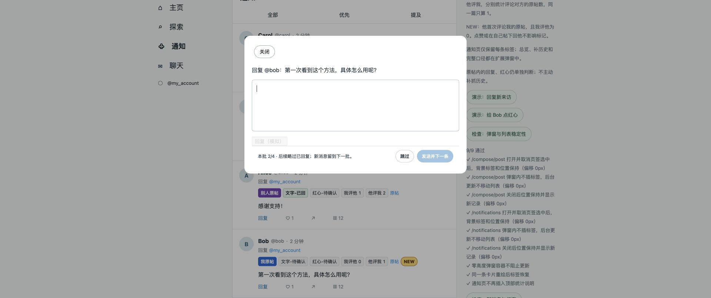
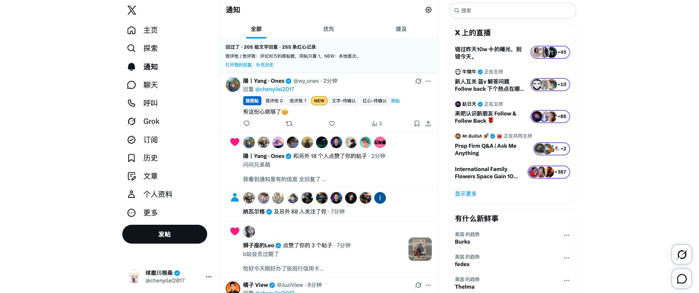
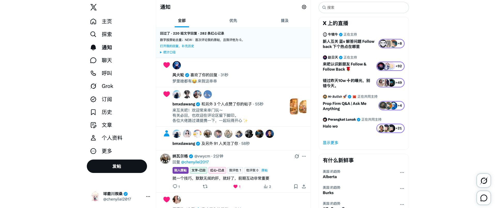
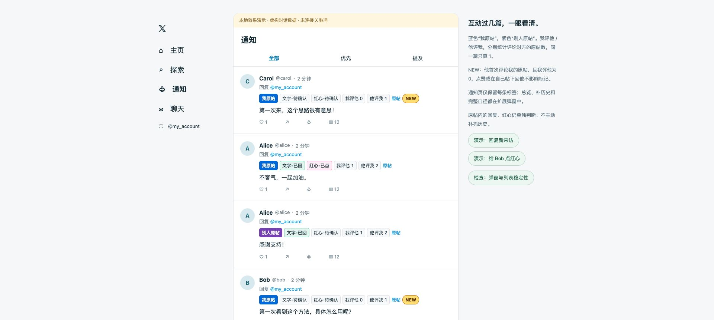

> 本文保留 README 首页整理前的完整说明与开发验证记录（0.4.0）。当前使用说明请见 [项目首页](../../README.md)。

# 回过了 · X 通知助手

Chrome 本地扩展，在 X 的通知页面额外显示：

- **蓝色「我原帖」/ 紫色「别人原帖」/ 原帖待确认**：按整段对话最初的原帖判断，楼中楼也属于同一原帖。
- **我评他 N / 他评我 M**：分别表示你评论过他的几篇原帖、他评论过你的几篇原帖。同一篇下评论 3 次也只算 1 篇，包含楼中楼；在自己或第三方原帖下回话、点赞不增加对应方向的数字。
- **黄色「NEW」**：这条是他第一次评论你的原帖，且“我评他”为 0。只标第一条评论通知，后续不重复标新；点赞、你在自己原帖下回复他不影响标记，你评论过他的原帖后不再标 NEW。判断基于本地已读取记录，不保证覆盖整个 X 历史。
- **文字-已回**：你在同一原帖里已经回复过该通知的作者。点击标签可查看自己的回复。
- **红心-已点**：你已经给这个人在同一原帖中的帖子点过红心。点击标签可查看点赞依据，可能是这段对话中先前的另一条评论。
- **文字-待确认 / 红心-待确认**：对应的本地记录不足，不能据此认定你从未操作。

**标签固定一行，NEW 固定在末尾。** 窄处可横向查看其他标签，NEW 不换行改变卡片高度。通知页仅保留每条消息的标签；总览、补历史入口和完整统计口径都在 Chrome 工具栏的扩展弹窗中，标签悬停也有说明。文字与红心各自判断。

展示顺序：**原帖归属 → 文字 → 红心 → 我评他 → 他评我 → 原帖链接 → NEW**。

打开回复框或其他弹窗时，保留通知列表原有标签，不往弹窗内插入标签。页面观察数据继续入库，关闭弹窗后再刷新显示；X 重绘同一张卡片时，会恢复缺失的标签。通知页不插入全局统计说明，避免占位和总数更新带来的布局变化。

通知卡片显示时即预留固定 36px 的标签区域，后台识别完成后在这里填入标签。新通知、状态变化和标签重建不会再改变该区域的高度。只在通知页正文或无正文卡片的操作栏前预留，引用帖和回复弹窗不插入；不主动调整页面滚动位置。

文字与红心状态按 **当前账号 + 原帖 ID + 对方用户 ID** 判断；两个人物数字按 **当前账号 + 对方用户 ID** 统计，并分别按原帖 ID 去重。换一篇原帖不会沿用“文字-已回”状态，但可看到双方评论过对方几篇原帖。所有 ID 保持字符串，避免大整数精度丢失。

例如：你的原帖 → Alice 留言 → 你回复 Alice → Alice 再回复，会显示“文字-已回、我评他 0、他评我 1”；随后你评论 Alice 的一篇原帖，变为“我评他 1、他评我 1”。在这两篇里继续互相回话，数字都不再增加。同帖中 Bob 新加入时，不会因为你回复过 Alice 就跳过 Bob。

如果你只给 Alice 的评论点了红心，后续同一原帖里 Alice 的通知显示“红心-已点”，文字仍单独判断。取消一条点赞会撤销对应红心记录；若同一原帖中还有其他点过红心的 Alice 的帖子，仍可显示“红心-已点”并链接到那一条。


## 安装

1. 在 Chrome 地址栏输入 `chrome://extensions`，开启右上角“开发者模式”。
2. 点击“加载已解压的扩展程序”，选择本项目的 **extension** 文件夹。
3. 刷新已打开的 X 页面，然后进入通知。也可以解压 `dist/x-reply-context-0.4.0.zip` 后，加载解压出的文件夹。

更新已有安装时，使用原来的扩展文件夹更新文件，在 `chrome://extensions` 点击扩展的“重新加载”，再刷新 X。无需卸载，原来的文字回复记录会保留。

扩展申请 `storage` 和 `unlimitedStorage` 本地存储权限，并在 `x.com`、`twitter.com` 页面运行。后者用于避免 10,000 条含文字的记录超过 Chrome 默认的本地容量；代码仍限制每类最多 10,000 条、保留 90 天。无运行依赖、服务端、API Key 配置、Cookie 导出。

## 第一次使用

日常照常打开“通知”，点赞、回复即可。页面返回的已点赞状态和安装后的成功点赞会自动记录，无需另开“我的回复”来记录红心。

也支持直接在“主页”帖子卡片上点击红心或评论按钮。发送成功后记录互动；对方的后续回复进入通知时，按同一原帖关联，不需要先打开帖子详情。不同原帖里的同一个人仍然分别判断。

人物统计直接利用已有本地缓存，之后随正常浏览更新，不会为了统计额外抓取历史。同帖多次评论、同一回复重复加载不会重复计数。只统计已确认原帖作者的记录，作者信息晚到后自动补计。数字是当前保留记录范围内的统计，不是终身总数；缓存到期或淘汰后可能减少。

需要补充旧的文字回复时，点击 Chrome 工具栏的扩展图标，再点“补充我的历史回复”。在自己的“回复”页向下浏览，加载近期关心的回复，然后回到通知页。不同标签页间的记录会自动更新。这是可选的补历史入口，未补充时可能有更多“待确认”。

扩展只能识别**安装后由该 Chrome 页面加载到的帖子、点赞状态和成功执行的回复/点赞操作**。没有自动扫描全部历史。手机、其他浏览器或安装前的操作，需要在这个浏览器里加载后才能识别。打开单条通知的上下文，也会补充页面实际返回的原帖和回复。缺少当前账号或原帖的可靠信息时，保留“待确认”。

标签只辅助判断；通知和 X 的原有操作入口仍然保留。点击回复按钮、输入草稿或看到回复数量，不会标为已回复。点赞必须得到成功回执或明确的已点赞字段；不会按按钮点击次数或点赞总数推测。取消点赞后更新对应记录；其他设备上的取消操作需要重新加载相关帖子后同步。

## 数据与实现

### 连续回复（0.4.0）

在通知列表点击一条的原生回复按钮，回复框下方会出现“发送并下一条”“跳过”和本批进度。填好文字后再点击新增发送按钮。原来的 X 回复按钮仍然只发送本条。

- 当前手动打开的一条由你决定是否再次回复；后续从其下方的已加载通知中选择，自动略过同一原帖里已文字回复过的人，仅点过红心的仍展示。点赞、关注等聚合通知不进入评论队列。
- 每批最多取当前已加载的 100 张通知卡片，顺序在打开第一条时固定。新通知不插入本批；本批结束后提示加载或查看下一批。若 X 已卸载下一条卡片，向下浏览后点“继续下一条”，不会无限滚动查找。
- 发送使用 X 原生按钮及其校验。回执必须匹配当前请求、回复目标和账号，成功记录到本地后再选下一条。发送中禁用重复操作；失败或结果不明时停下，不自动重复发送。超时后才确认成功时，由你点“下一条”继续。
- “跳过”只影响本轮，不标记已回复，不永久忽略这个人。有未发送内容时使用 X 原生关闭及“保存草稿”，草稿在 X 中保留。无法识别保存确认时会暂停，不会选择丢弃；仅在你确认后继续。
- 手动关闭回复框退出连续处理，通知列表保留在弹窗下方。切换账号或离开通知流程也会停止。每条发送都需要你点击，插件不生成回复内容。
- 兼容当前安装的 XReply 0.3.2：识别 Tab 逐字填入目标及公开的“改写中”提示，期间禁用新按钮，完成后恢复。空编辑器中的生成候选不阻止跳过。没有改动 XReply 的源码或设置；其他版本的 DOM 标记变化需要重新验证。



### 当前实现

- `extension/core.js`：归一化 X 的通知及 GraphQL 帖子数据；识别原帖，将文字和红心分别按账号记录，并生成按人的评论统计。
- `extension/observe.js`：读取 X 页面本身已经成功返回的指定帖子接口响应。点赞、取消点赞和文字回复请求只保留目标帖子 ID；文字回复额外关联请求 ID 与成功回执，不保存未发送草稿。操作绑定请求时的账号。旧页面响应不会覆盖更新的成功操作。不主动发出补查请求，不修改请求参数，不读取请求头或凭据，不处理私信接口。
- `extension/background.js`：串行合并多个标签页的记录，保存到 `chrome.storage.local`。
- `extension/continuous.js`：管理当前批次、原生回复框按钮、成功回执关联及草稿确认；只在本页保留临时队列。
- `extension/content.js` / `content.css`：在通知卡片中插入标签和证据链接，处理动态滚动和账号切换。
- `extension/popup.*`：首次使用说明及历史回复入口。
- `tests/`：核心场景自检和使用生产标签代码的本地模拟通知。

本地记录保留 90 天（按最后观察时间），帖子、用户、原帖索引、回应索引、点赞状态和人物关系各最多 10,000 条。缓存到期或淘汰后，如果缺少证据，回到“待确认”。仅存帖子关系、用户 ID / 用户名、点赞状态、人物统计及最多 200 字的帖子片段。互动统计不会上传；回复发送和草稿保存通过 X 原生功能完成。卸载扩展会清除该扩展的数据。

人物关系使用一个字典：`people["我的ID:对方ID"] = { myCommentedPosts, theirCommentedPosts, firstCommentOnMyPostId, seenAt }`。两个数字分别对应“我评他”“他评我”，复用现有帖子及回应索引，按原帖 ID 和方向去重，不额外保存一套评论明细。`firstCommentOnMyPostId` 只记录对方在我原帖下最早的评论 ID，不包含他在自己或第三方原帖里对我的回复。升级时根据缓存重新计算，保留原有回复、点赞记录；NEW 不再使用旧的已互动标记。

NEW 需要同时满足：当前原帖属于我、当前通知是此人首次评论我原帖的那条、我评他为 0。原帖归属未知时不标 NEW，信息补全后重算。已有最早评论 ID 会随人物记录保留，后续评论不会因为第一条从帖子缓存淘汰就被重新标新；人物记录整体过期或未读取的历史仍会影响判断。因此 0、NEW 和“待确认”都只表示本地记录，不等于完整历史事实。

X 网页使用的接口和页面结构可能变化。匹配不到响应或页面未加载完整时，无法保证自动分类；不会用内容猜测对话关系。“文字已回复”表示发现你回复过此人的记录，不保证该回复此刻仍未被删除；红心也以本机最后观察到的状态为依据。

## 开发与验证

需要 Node.js 22 或更高版本，无需 `npm install`：

```sh
npm test
npm run preview
npm run package
```

预览入口为 `http://127.0.0.1:5818/notifications`，使用虚构账号与帖子，不会发送真实回复或点赞。按钮可分别演示回复、点赞和取消点赞，观察两项独立变化。

页面的“检查：弹窗与列表稳定性”会使用真实 `content.js`，模拟回复弹窗切换到 `/compose/post`、不切换路径的弹窗、期间的本地记录更新、关闭弹窗及卡片重绘。检查结果显示在演示页，测试代码仅在 `tests/` 中，不会打包进扩展。

“检查：新消息与行高”还会同步测量新卡片刚插入的高度、后续标签填入的高度、窄卡片回复后的变化，以及标签被移除一瞬间的高度，覆盖仅比较最终位置会漏掉的中途变化。

2026-10-20，v0.1.0 验证：11 项自检通过；Chrome 中验证了生产标签代码的显示与状态更新；核对了真实 X 通知页的账号、卡片、正文和时间线 DOM 选择器。**当时尚未把扩展加载到用户 Chrome，因此网页响应采集、真实历史补充和真实发送后的自动识别尚未完成端到端验证。** 模拟演示不能代替这部分验证。

2026-10-20，v0.2.0 验证：17 项自检通过，新增文字/红心独立、取消点赞、旧响应顺序、账号隔离及 fetch / XHR 成功回执检查；Chrome 模拟页面验证了同时显示和点赞/取消点赞的独立更新。真实 X 环境中的扩展采集仍待安装后验证。保留 v0.1.0 安装包及旧预览图作为前版记录。

2026-10-20，v0.2.1 修复与实测：

- 真实 Chrome 中发现，“我的回复”已使用 `UserRepliesTimeline`，旧版只匹配 `UserTweetsAndReplies`，因此漏采历史响应。增加新接口匹配，保留旧接口。
- 回归检查通过真实观察器的 XHR → 解析 → 入库路径复现：修复前历史加载后记录仍为 1 组，修复后增至 2 组。共 18 项自检通过。
- 在已登录的真实 X 页面加载历史并翻页，两批响应分别采集到 42 和 38 条帖子。开始诊断时为 12 组文字回复、21 条红心；补录后显示 44 组文字回复、53 条红心。记录数按原帖与对方组合统计，同一组合多次回复不会重复增加。
- 已将本机原扩展更新至 0.2.1，重载后计数保留；临时诊断日志已移除。此次实际验证了历史读取与通知展示，没有发送新回复或执行点赞来测试写入。


2026-10-20，v0.2.2 修复与实测：

- 真实主页仍使用 `HomeTimeline`，已采集到 41 条帖子；真实通知页已使用 `NotificationsTimeline`。旧版只接入旧通知接口，导致新的通知帖子缺失，即使对应互动已保存，也会显示“原帖待确认”。补上这个实际通知接口。
- 新增完整回归：主页加载原帖 → 点赞成功 → 评论成功 → 新通知到达 → 关联原帖及文字/红心记录。修复前可复现“原帖待确认”，修复后通过；共 19 项自检通过。
- 真实通知响应采集到 17 条帖子、14 条回复；此前未打开详情的“一起卷啊”通知自动关联到他人的原帖，并显示文字已回复和红心已点。验证使用现有真实通知，没有额外发送测试评论。
- Chrome 扩展管理页已确认加载 0.2.2；安装目录与源码一致，临时诊断日志已移除。扩展更新后，之前打开的 X 标签页需要刷新一次。
- 用户确认继续按“同一原帖、同一个人”判断，不跨原帖沿用互动记录。保留前版安装包和验证截图。


2026-10-20，v0.3.0 验证：23 项自检通过，覆盖 10,000 条上限、双方评论对方原帖的去重统计、楼中楼归属、账号隔离、原帖作者晚到、旧缓存重算及首次来访标记。Chrome 模拟页确认全部标签在同一行，展示蓝紫原帖样式、黄色 NEW 和“我评他 / 他评我”；在自己的原帖模拟回复 Carol 后，文字变为已回、NEW 消失，“我评他 0 / 他评我 1”保持不变。无额外历史接口请求。

本机原扩展已更新并重载为 0.3.0，9 个运行文件与源码一致。真实 X 通知页已显示单行双向原帖数及 NEW；原有 205 组文字回复、255 条红心记录保留。此次使用现有通知核对显示，没有发送新的真实测试评论。



2026-10-20，v0.3.1 调整与验证：

- NEW 改为“他首次评论我的原帖，且我评他为 0”，仅首条评论通知标新；点赞和在自己的原帖下回话不影响标记。旧缓存本地重建首条记录。
- 展示顺序改为“原帖归属 → 文字 → 红心 → 我评他 → 他评我 → 原帖链接 → NEW”。窄版演示中主要标签宽 380px、可用宽 391px，NEW 单独换到第二行，主要标签没有被挤出。
- 通知顶部新增折叠的“统计口径”，插件弹窗和悬停提示同步说明原帖、去重计数、NEW、文字/红心、待确认及本地数据范围。
- 24 项自检通过。Chrome 已确认重载 0.3.1，真实通知页显示新顺序及口径入口；更新后仍有 220 组文字回复和 282 条红心记录。此次没有发送真实测试评论。



2026-10-20，v0.3.2 列表稳定性修复：

- 旧版在回复框路径不属于 `/notifications` 时清空了背景标签和说明；计数更新还会重建说明区、丢失展开状态。同一张卡片被 X 重绘时，仅检查帖子 ID 会漏掉已经消失的标签。
- 现在弹窗期间只继续保存观察数据，保留背景布局，关闭后更新；跳过重复渲染前会确认标签仍然存在。
- 通知顶部的全局统计、补历史入口和统计口径全部移到插件弹窗。总览在弹窗上方显示，附带“组回复 / 条红心”的计数解释。
- 原版复现中打开回复框时测试卡片偏移 -362px；最终 8/8 界面回归通过：开关弹窗及期间更新保持 0px，关闭后新记录显示，重绘后标签恢复，顶部说明不再出现。原有 24 项逻辑检查通过。测量来自本地模拟页面，不代表 X 自身所有布局变化都已消除。
- Chrome 扩展管理页确认已重载 0.3.2；新打开的真实通知页读取到 11 组卡片标签、0 个顶部统计说明区。此前已打开的 X 页面需刷新一次。
- 保留 [修复前结果](../layout-before-0.3.2.json)、[首次修复结果](../layout-after-0.3.2.json) 及 [移除顶部区域后的结果](../layout-after-no-banner-0.3.2.json)。没有发送真实测试评论。



2026-10-21，v0.3.3 行高与新消息修复：

- 真实通知 DOM 使用 `cellInnerDiv` 绝对定位和 `translateY` 排列卡片。旧版等识别后再插入标签，卡片高度才增加；NEW 换行及重绘时标签消失也会改变高度。
- 新增复现：0.3.2 新通知填标签后增加 35px，并把下面的旧通知再推下 35px；窄卡片回复、点赞后减少 30px；标签移除时缩小 35px。原来的最终位置检查没有覆盖这些中途变化。
- 现在由通知选中页签限定的 CSS 先预留固定标签位，标签在其中定位；状态更新保持一行。弹窗判断排除零高度容器，避免无可见弹窗时仍暂停刷新。
- 24 项逻辑检查、5 项新消息与行高检查、9 项弹窗及重绘检查通过。本地新增的高度变化全部为 0px；这是插件引入高度变化的回归证据，不涵盖 X 自身排序、媒体加载等所有变化。
- Chrome 已确认重载 0.3.3，真实通知页抽查 5 个标签均为 26px 高、父容器预留 36px，距正文 6px。此次没有执行真实回复或点赞。
- 保留 [修复前行高](../heights-before-0.3.3.json)、[修复后行高](../heights-after-0.3.3.json) 和 [弹窗回归](../layout-after-0.3.3.json)。没有发送真实测试评论。

2026-10-21，v0.4.0 连续回复验证：

- 25 项逻辑检查通过。新增协议检查覆盖 fetch / XHR、Request 克隆、不消费原始请求正文、请求及目标关联、失败、账号切换、原帖不触发连续回复、部分成功或服务端错误保持未确认。
- 本地演示使用生产 `observe.js`、`continuous.js`、`content.js` 及模拟原生发送 / 草稿接口：初始 6 条通知筛为当前条及后续 3 条；成功后进入下一条，已点赞的 Bob 通知仍进入队列；失败保留输入和目标，修改后可重试。
- 本地完整流程产生 4 次模拟请求、3 次成功、1 次明确失败。跳过的一条保存为 X 原生草稿模拟记录，未标记为已回复；处理中到达的新通知未插入本批。
- 发送中按钮禁用；主动关闭后迟到的成功回执没有继续打开下一条；目标不匹配的回执停在未确认，不把当前通知标成已回复。
- XReply 逐字填入模拟逐字检查按钮状态：填入中保持禁用，完成后恢复；保存的草稿包含完整文字，下一人的编辑器为空。已只读核对本机 XReply 0.3.2 的公开 DOM 标记及行为，未改动该扩展。
- 真实界面发现 X 打开回复弹窗时会将通知页签全部设为未选中，原来的 CSS 因此撤掉标签预留空间。已改为按通知页签链接识别背景列表，不依赖选中状态；补入该真实行为后，修复前本地检查复现 40px 位移。新增工具栏放在原生操作区内，避免落到透明弹窗容器外。
- 修复后 9 项弹窗布局、5 项新消息行高检查全部通过，相关偏移均为 0px。本机 Chrome 已确认重载 0.4.0；真实通知回复框中两个按钮显示正常，通知卡片打开前、打开中、关闭后均为 157px 高，标签预留 36px、距正文 6px。验证截图见 [真实回复框](../continuous-reply-live-0.4.0.jpg)，测量见 [真实布局记录](../layout-live-0.4.0-tab-deselection.json)。验证后关闭了空白回复框，保留原安装目录及统计记录；此前打开的 X 标签页需刷新。
- 回归列表行高和弹窗布局；真实账号没有代发测试评论。原生发送成功后的完整真实链路和原生草稿保存仍需在正常使用中确认，模拟结果不替代实发验证。

字段依据：[X 的 Conversation ID](https://docs.x.com/x-api/fundamentals/conversation-id)；网页响应结构参考 [Twikit 的 Tweet 数据读取](https://github.com/d60/twikit/blob/main/twikit/tweet.py)。扩展注入方式见 [Chrome Content scripts](https://developer.chrome.com/docs/extensions/reference/manifest/content-scripts)。

点赞请求字段参考 [Twikit 的 GraphQL 调用](https://github.com/d60/twikit/blob/main/twikit/client/gql.py)；成功回执参考 [go-twitter 的回执解析](https://github.com/anatolykoptev/go-twitter/blob/main/parsers.go)。

本地容量依据：[Chrome Storage 的容量限制](https://developer.chrome.com/docs/extensions/reference/api/storage#storage_areas)。`unlimitedStorage` 只扩大扩展自身存储配额，实际记录量仍由代码上限控制。
