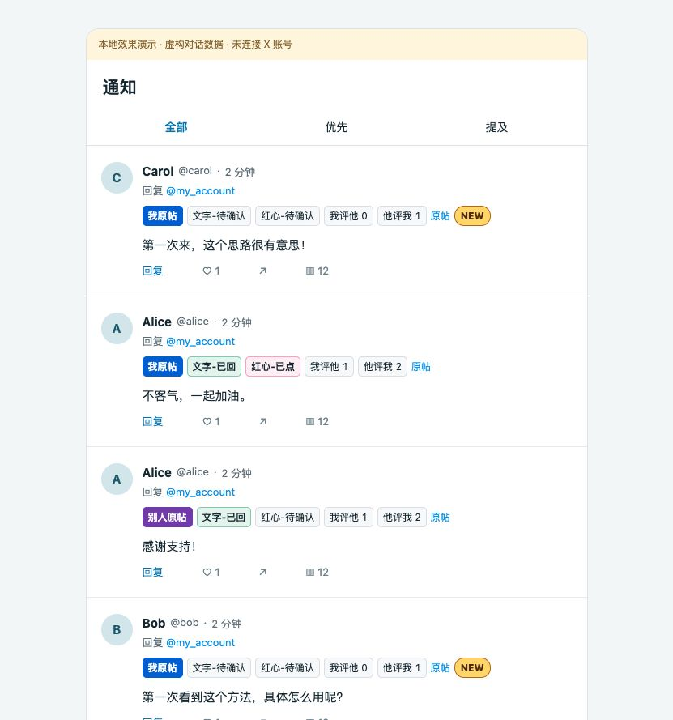
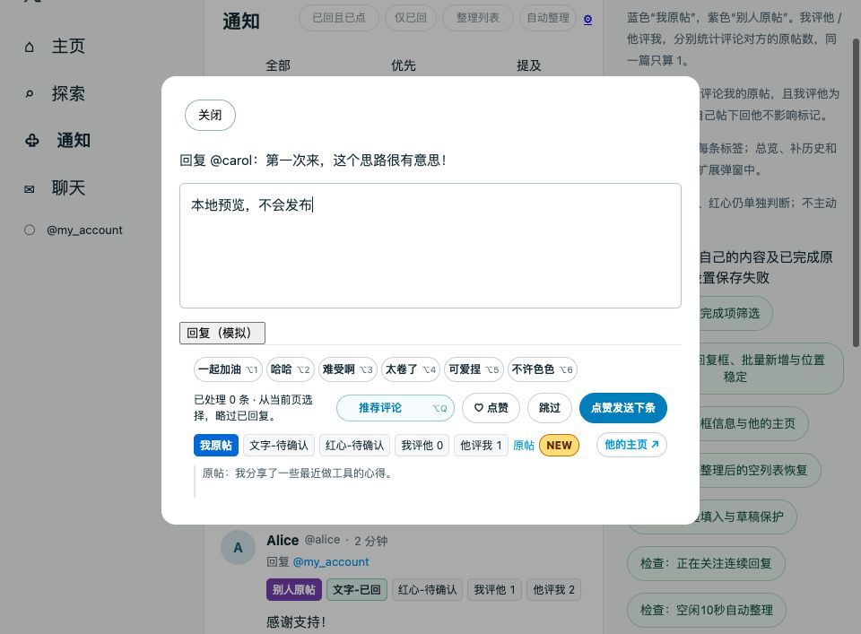
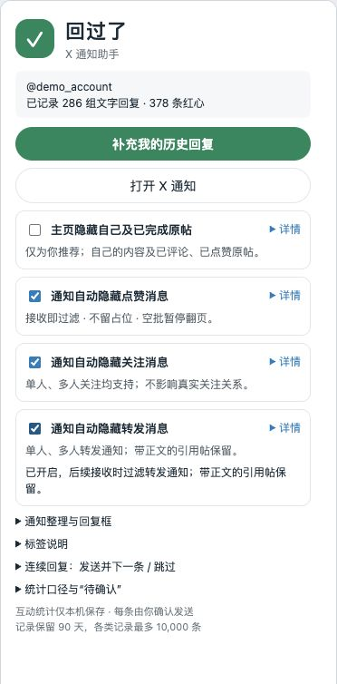

# 通知标签与筛选

[← 返回 README](../../README.md)

## 界面预览

**通知里，一行看清是否互动过。**

  

展开查看实际代码渲染的回复框与筛选设置

**回复框本地演示（0.16.8 历史截图）。** 当前主页入口已改为「伴随主页」，新操作见上方示意图。

  

**三个独立通知过滤开关。**

  

转发过滤**默认关闭**，图中为手动开启后的示例。设置说明可点「详情」展开。

本节截图为扩展实际代码渲染的本地演示，账号、帖子及统计为虚构数据，不代表真实发送验证。

## 通知筛选

| 开关 | 默认 | 在哪里设置 |
| --- | --- | --- |
| 通知自动隐藏点赞消息 | **开启** | 扩展弹窗；包含点赞原帖、喜欢回复及多人聚合点赞。 |
| 通知自动隐藏关注消息 | **开启** | 扩展弹窗；包含单人、多人关注。 |
| 通知自动隐藏转发消息 | **关闭** | 扩展弹窗；包含单人、多人「转发了你的帖子」事件。 |
| 已回且已点 / 仅已回 | **均关闭** | 通知标题栏；互斥选择，再点当前条件关闭。升级保留原开启状态。 |
| 自动整理 | **关闭** | 通知标题栏；配合任一隐藏条件使用。 |
| 主页隐藏自己及已完成原帖 | **关闭** | 扩展弹窗；仅作用于主页「为你推荐」。 |

**开关会记住你的选择。** 点赞、关注、转发在接收时按事件类型过滤，带正文的引用帖、评论和未知事件保留。它们不会先进入列表再逐条折叠，避免堆积隐藏占位。

**改完事件过滤开关后，手动刷新 X 可应用到当前列表。** 设置影响后续接收；关闭开关后刷新也能恢复此前过滤的通知。扩展不自动刷新、不删除通知，也不取消真实互动。

**一批全被过滤就停下。** 点通知顶部的「整理列表」或浮层「继续加载」，每次放行一批原生请求。随后逐批手动确认，顶部新评论照常接收。打开回复框时暂停翻页操作。

### 已完成互动怎样整理

- **已回且已点**：评论按同一原帖、同一个人判断；两项均有依据才可隐藏，只做一项或待确认时保留。引用帖/原帖卡片要求评论过该原帖，并点赞本帖。
- **仅已回**：按同一原帖、同一个人的文字回复依据隐藏，不要求红心，已点赞的也包含；他人原帖/引用帖按已评论该原帖判断。待确认、自我回复不据此隐藏。与上一条件互斥，已选条件再次点击即关闭。
- **整理列表**：手动一次应用已加载内容的最新完成状态。如果当前已加载帖子全部符合隐藏条件，会显示“本批帖子均已隐藏”和「显示本批」。点击恢复当前卡片，保留筛选条件且不自动再收起；也可再次点击已选条件关闭隐藏。记录不会删除。
- **自动整理**：主动操作后空闲 10 秒，只整理一轮视口下方 600px 之外的完成评论。当前及上方保留，回复框和后台暂停；新数据、补位和页面自行滚动不会续清。

标题栏控件保持固定位置。X 自身的媒体加载、虚拟列表和新消息排序仍可能影响滚动位置。

主页「为你推荐」的隐藏规则

开启后，自己的帖子和回复直接隐藏；其他人的原帖需评论过（含楼中楼）且点赞该原帖本身，才会隐藏。仅评论、仅点赞或待确认时保留。关闭开关可恢复当前卡片，本地互动记录保留。

回复框打开时暂不改变背景折叠状态。此规则不作用于「正在关注」、自定义页签或通知页；这些入口照常记录互动。

## 标签说明

通知列表按 **原帖归属 → 文 → 红 → 我评 → 他评 → 原帖链接 → 关／粉 → NEW** 显示，窄处可横向查看。

| 标签 | 含义 |
| --- | --- |
| **我帖 / 他帖** | 蓝色代表我的原帖，紫色代表别人的原帖。楼中楼沿用同一原帖。 |
| **文-已回** | 找到本地回复依据，可点开查看。评论按同帖同人判断，原帖/引用卡片按该原帖下的评论判断。 |
| **红-已点** | 找到本地点赞依据，可点开查看。评论按同帖同人判断，原帖/引用卡片必须点赞本帖。 |
| **我评 N / 他评 M** | 双方各评论过对方的几篇原帖，同篇只算一篇。历史不完整时，数字是本地已知下限。 |
| **NEW** | 本地记录中他第一次评论你原帖的那条通知，且「我评」为 0。 |
| **待定** | 当前记录不足，无法确认。 |

> 所有互动标签都基于本浏览器已读取并保留的记录。

统计口径与例子

文字、红心分别判断，按**当前账号 + 原帖 + 对方**区分。你回过 Alice，不会把同帖的 Bob 标成已回；Alice 换到另一篇原帖，也重新判断。

「我评／他评」按对方不同原帖去重，包含楼中楼。Alice 在你的原帖留言，你回她后她又回复，会显示「文-已回、我评 待定、他评 1」。你评论 Alice 的一篇原帖后，「我评」才显示 1。

NEW 只标首次评论的那一条，后续不重复。历史不完整或容量不足时不推断 NEW。点赞、你在自己帖下回她不影响标记；你评论过她的原帖后不再标 NEW。

带正文的引用帖按外层作者的新原帖判断，不借用内嵌被引用帖的互动记录。

总览中的“组文字回复”与“条红心”不是同一个单位：前者按原帖和对方去重，后者按具体帖子去重并只计已点；历史回复补录也不保证同步补齐历史点赞。
