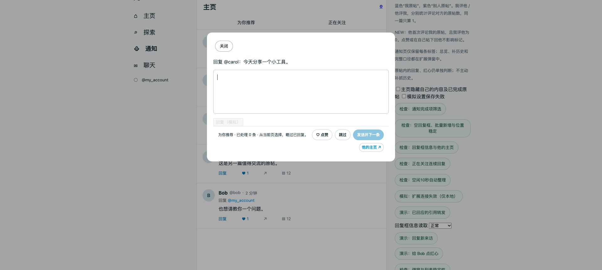

# 0.15.6 主页回复框的主页入口与输入性能

## 功能

「为你推荐」「正在关注」的回复框操作按钮下方新增固定高度的「他的主页 ↗」，链接使用当前回复对象的本地 `authorHandle`，不使用原帖作者或内嵌引用帖作者。点击另开标签页，保留当前回复框和草稿；缺少作者或读取失败时保留占位并禁用链接。

主页仅新增主页入口，不搬入通知的统计标签或原帖摘要。通知的统计、摘要和主页入口继续保留。所有资料读取复用本地分类缓存，没有新增 X 请求、自动发送、点赞或关注。

## 本次性能审查与优化

- 原先每次输入都会扫描已挂载列表寻找当前红心。现在保留当前卡片引用，每次使用前校验连接状态、所属列表、帖子 ID 与隐藏状态；X 重绘或复用卡片后才重新查找，避免操作旧对象。
- 编辑输入与改写提示变化共用现有逐帧调度，当前帧的多次变化只刷新一次。回复框外的输入不触发这条调度。
- 回复资料只在数据对象或底栏节点变化时更新，避免输入时反复序列化标签、处理原帖文字、改写主页链接。同一轮渲染只计算一次多帖编辑状态。
- 下一条仍只检查已加载候选，每批最多 100 条，本地分类；成功回执持久化后再前进，保留账号、请求目标和页签校验。没有新增分页、后台轮询或持久化字段。

本地 Chrome 同一场景中，连续 100 次输入事件导致的整页卡片扫描由 **101 次降为 0 次**。这是扫描次数对照，不是端到端毫秒数或真实 X 网络性能承诺。

## 验证

- 74 项 Node 自动检查通过。
- 主页连续回复 11/11：包括为你推荐/正在关注入口、主页指向、100 次输入、虚拟卡片换 ID、红心保存、普通及长评论记录、跳过、切换页签和晚到回执。
- 通知回复框 13/13：标签与摘要、作者归属、固定行高、慢读取跳过、缺失作者、读取失败及底栏重绘恢复。
- [结构化浏览器证据](continuous-0.15.6.json)。测试全部使用本地虚构账号；没有操作真实 X 账号。测试中的模拟发送不代表生产发送验证。

本次不改存储与索引架构；冷启动和关系重建的已有开销仍存在。源码、文档和安装包同步到 0.15.6 后，需重载扩展并刷新 X 才会应用。本次发布包含源码、README、更新日志、安装包及本地验证记录。
