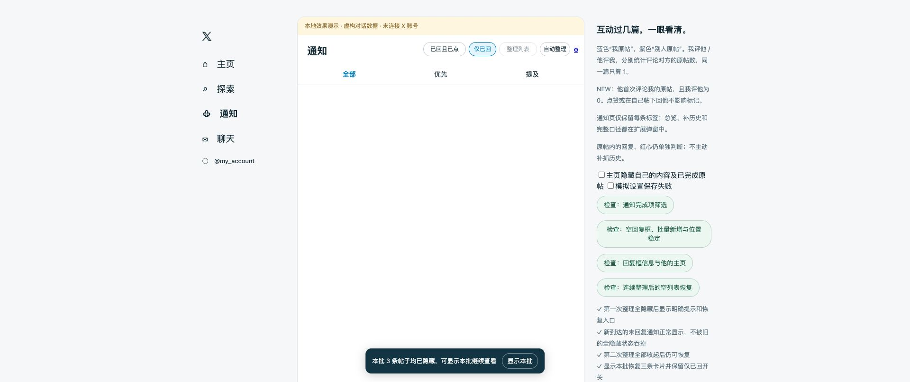

# 0.15.9 整理后的空列表恢复

## 现场与原因

现场当前页 19 条卡片全部被「仅已回」收起，卡片及其虚拟行的高度为 0，而 X 的列表容器仍有约 758px 最小高度。之前只有网络过滤得到空批时才显示暂停提示，未覆盖 DOM 整理造成的全隐藏，所以留下空白且没有明确恢复入口。仅说明“卡片被隐藏”不足以解决这个浏览问题。

## 修复范围

- 利用已有卡片处理循环记录本批总数与隐藏数，不增加滚动扫描或后台读取。
- 本批帖子全隐藏时，显示“本批 N 条帖子均已隐藏”和「显示本批」。恢复当前挂载卡片，保留筛选条件与记录，不强制刷新页面。
- 恢复会取消未完成的整理，阻止旧异步分类覆盖恢复结果，并停止当前自动整理轮次。下一次真实用户活动仍按原来的空闲/阅读区保护规则执行。
- 与原有网络暂停提示共用同一个固定提示条，避免两个浮层重叠。存在网络暂停时仍保留单次「继续加载」；「显示本批」不放行分页、不创建 X 请求。
- 回复框打开、账号/页面不匹配时不改变背景布局；新到达且可见的通知会正常显示并收起全隐藏提示。标题栏控件位置不变。

没有伪造下一页游标、自动请求补位或更改 X 的虚拟列表高度缓存。只恢复当前仍挂载的卡片，不承诺找回已经被 X 卸载且不在本批中的历史内容。本次安装包也包含 0.15.8 的快捷填入修复。

## 验证

- 修复前，本地“全隐藏后没有可用的恢复入口”检查失败。
- 77 项 Node 检查通过：新增两轮整理后恢复、保持筛选、60 秒不自动续清、回复框/切页保护、与网络暂停共存且恢复不放行分页。
- 本地浏览器 6 项恢复检查通过：两次全隐藏均可恢复，新到通知正常显示，恢复后保留筛选，按钮位置不变，发送/点赞为 0。
- 24 组原有接口/入口稳定性检查通过。
- 本地网络响应模拟：初批过滤 1000 条点赞/关注；第二批全点赞暂停。点击一次「继续加载」后请求数从 2 到 3，下一次补位请求继续等待，没有连翻；阅读锚点均为 146.5px。
- [结构化证据](empty-recovery-0.15.9.json)。全部写操作验证在本地虚构数据中完成；真实 X 本轮仅只读保留现场，更新后真实页面仍需重载确认。

复现入口：`npm test`；`npm run preview` 后打开 `/notifications` 的“连续整理后的空列表恢复”，或 `/tests/network-demo.html` 核对空批暂停。
