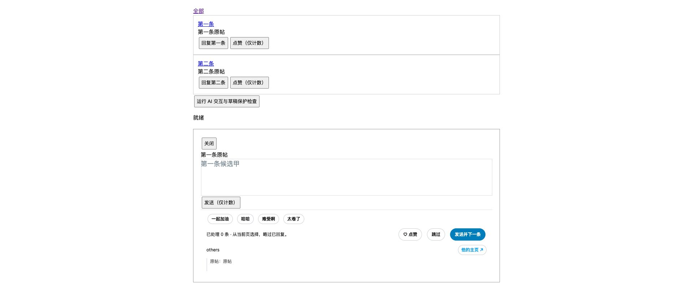

# 0.16.0 · 自带 API 回复整合

基准：0.15.11（`6cfc73b`）。独立实现 XReply 0.3.2 自带 API 模式的功能和操作习惯，没有并入其源码、默认 Prompt、云登录或订阅服务。默认关闭；用户停用原 XReply、填写自己的模型配置后启用。

图标补充：`assets/icon/x.svg` 为可编辑源文件，`extension/icon-{16,32,48,128}.png` 用于工具栏与扩展管理页；静态资源，不增加页面脚本或请求。

## 功能与模块

| 文件 | 职责 |
| --- | --- |
| `ai-config.js` | 接口地址、配置约束与独立编写的默认 Prompt |
| `ai-service.js` | 本地配置、独立模型调度、SSE 读取、取消及错误反馈 |
| `ai-replies.js` | 当前编辑器会话、灰字候选、快捷键、草稿版本和旧任务退出 |
| `editor.js` | 原快捷填入的受控粘贴路径，AI 与快捷短语共用；同一编辑器互斥写入 |
| `ai-settings.html/js` | Base URL、Key、模型和生成／改写 Prompt 设置 |

初始三候选；空草稿上下切换，末尾补一条；Tab 采用剩余建议并逐字填入；Option+Tab 改写。输入取自当前回复弹窗已有的被回复文字，不用截断的原帖缓存替代，不补抓 X。改写额外发送当前草稿。支持 `https` 和本机 `http` 的 OpenAI 兼容 `/chat/completions`，SSE 收齐后显示候选，与原习惯一致。

关闭、跳过、切换对象、账号、配置或后台隐藏会撤销当前会话。响应校验编辑器实例、引用文字节点、账号及配置版本；下一次回复操作立即使旧会话失效。改写校验草稿版本和内容；快捷短语与 AI 不并行写入。AI 填入／改写期间连续发送、跳过和快捷按钮暂停，原生发送点击及 Ctrl/Command+Enter 同样受保护。不会自动发送或点赞。

## 性能边界

- 后台 `AI_*` 直接路由到独立调度，不排入 INGEST／CLASSIFY 队列。模型慢不会让记录保存等它返回。
- 没有新增全页 MutationObserver 或轮询；复用现有刷新调度。普通按键不进入 AI DOM 查询，关闭 AI 后刷新立即返回。
- 灰字是绝对定位覆盖层，不增加列表或编辑器高度；只有候选或输入变化才更新文字。通知过滤、分页、计数和存储模块没有修改。
- 全扩展最多 3 个在途请求、12 个等待；从入队开始 25 秒超时。关闭会话取消等待／在途任务；无自动重试风暴。
- 单请求输入帖子上限 20,000 字符、草稿 10,000；响应上限 1 MiB，输出上限 12,000 字符；当前会话最多保留 32 条候选。历史数据不参与生成热路径。
- Key、模型及 Prompt 只存 `chrome.storage.local`。只申请用户配置的模型域名；不读取旧插件凭证，不使用 Chrome 同步，也不把 Key 返回给内容页的状态查询或网页消息通道。本地保存不代表加密保管。

## 验证

1. Node 测试 **83/83**：包括原有测试与 6 项 AI 后台测试。覆盖模型等待不阻塞记录／分类、SSE 中文分片和 DONE、全局并发、等待上限、跨标签取消隔离、配置修改取消、超大响应及错误清理。
2. Chrome + React 17 / Draft.js 0.11.7，模型响应为本地模拟：**14/14**。覆盖初始三候选、刷新去重、上下键、尾部补候选、采用／改写、发送保护、新草稿保留、跳过及关闭不串写、禁用 AI 无请求。
3. 原快捷短语真实 Draft 受控编辑器 **5/5**：空编辑器、已有草稿、选中文字、拒绝粘贴和同帧双击；都没有重复填入，没有发送。
4. AI 模块已加载但关闭时，既有主页连续回复检查 **11/11**：普通／长评论记录一次、红心、跳过、页签切换、晚到回执及主页入口正常；连续输入 100 次不重新扫描整页卡片。首次误从通知演示启动，被测试前置条件阻止；改从 `/home` 运行后通过。
5. 本机小型受控页面对同一回复框重复调用 AI 刷新 100 次约 **0.2ms**，没有多发候选请求。此项仅用于确认重复调度不会重复生成，不是实际 X 页面帧率、模型网络速度或大规模性能承诺。

[结构化证据](ai-replies-0.16.0.json)

## 尚未验证与启用步骤

后续已补充 [真实回复框有限验收](0.16.0-live-check.md)，以下保留实现阶段的原始验证范围。

本次没有读取用户已有 Key，没有调用真实模型，没有在真实 X 账号发送、点赞或关注。具体模型端点、用户自定义 Prompt、真实 X 编辑器最新结构及其原生草稿保存仍待正常使用确认。Windows Alt+Tab 被系统占用，未新增替代快捷键；不声明支持 pro.x.com 或云托管模式。取消 fetch 不保证模型服务端停止计算或计费。

安装包及原安装目录已同步。手动重载到 0.16.0、刷新 X，停用原 XReply，在「AI 回复设置 · 自带 API」中填写接口、Key、模型及自己的 Prompt，再开启并保存。默认关闭避免两套插件同时处理输入；原有筛选与互动记录无需迁移。实现阶段记录形成于 Git 提交之前。
