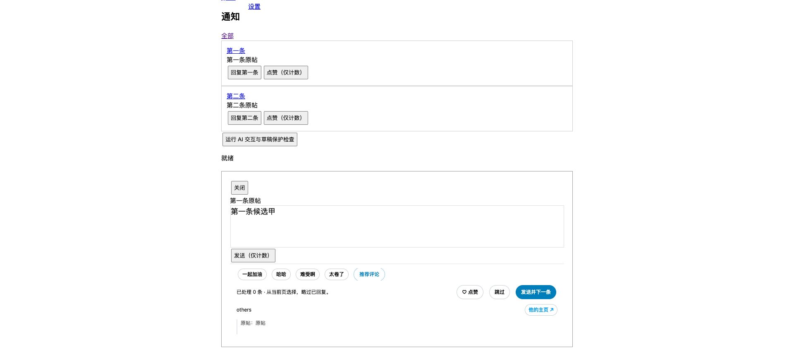

# 0.16.1 · 默认手动推荐评论

## 行为

扩展弹窗新增「自动 AI 补全」，使用独立本地键 `aiAutoComplete`，未设置时关闭。从 0.16.0 升级不改 API 配置、Key、模型或 Prompt；之前没有这个开关的用户会进入手动模式。以后手动开启的选择会保存。

通知、主页为你推荐和正在关注的连续回复工具栏，在四组快捷短语旁新增「推荐评论」。每次主动点击只请求一条，返回后一次追加到草稿末尾。有原文时用空格分隔，不替换原文或选中文字；不自动发送和点赞。等待期间继续编辑、关闭、切换对象或改变设置时，不填入旧结果。等待期间按钮及发送／连续跳过暂时置灰，用户仍可输入或手动关闭。

主 AI API 开关仍在 AI 设置页，未配置或未开启时点击推荐会提示设置。自动补全关闭后，手动推荐和 Option+Tab 改写仍可使用；开启自动补全后保留原来的灰字三候选、上下切换、Tab 采用。

## 性能与实现

- 关闭自动补全后，打开回复框及重复刷新不请求模型。手动推荐单请求，等待中防连点；不启动三候选预取。
- 复用已有模型队列、会话取消、草稿版本与受控粘贴；无新增 X 请求、全页观察器、轮询或历史数据扫描。
- 按钮使用现有快捷行，标签保持固定，避免等待时按钮文字长度变化。
- `popup.js` 复用现有复选框存储逻辑；独立开关不经过密钥配置读写，不向弹窗传 Key。

## 验证

- Node 测试 **84/84**，包含独立开关默认值、切换与保留手动生成能力。
- Chrome + React 17 / Draft.js 0.11.7，模拟模型 **20/20**：默认零请求、单次手动生成、防连点、已有草稿追加、等待中新输入保护、失败恢复、关闭取消，以及原自动候选／改写／跳过流程。
- 测试最初在状态恢复与按钮下一帧更新之间过早点击，出现未触发操作的失败；将测试等待改为等待按钮真实可用，完整检查通过，没有通过放松生产草稿保护规避。
- [结构化证据](manual-ai-0.16.1.json)。本轮未调用真实模型、未在 X 发送或点赞；真实新按钮仍需重载后确认。
- 原安装目录与安装包同步，不改用户保存的 API 配置。

## 独立整体审阅

用户要求的子 Agent 已完成基于 0.16.0 的只读整体审阅。发现 4 项问题，优先修复 XHR 复用误记、同响应部分对象覆盖；另外是重复观察全量重建和单响应 500 条截断。未在本次小功能中修改观察／存储链路，也不把审阅发现视为已修复。

[完整审阅报告及边界](architecture-audit-0.16.0.md)。
