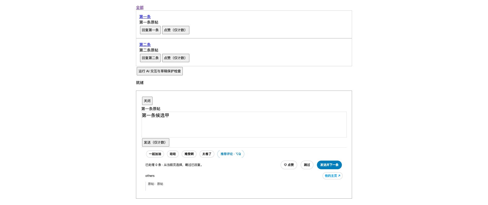

# 0.16.3 · Option+Q 推荐评论

在当前回复输入框按 **Option+Q（Mac）／Alt+Q（Windows）**，等同点击「推荐评论」；按钮显示快捷键并提供 aria-keyshortcuts。按用户指定采用 Q，不占用原有 Ctrl/Command+Enter 发送相关按键或 Option+Tab 改写。

复用原按钮操作与全部保护条件；仅当前回复会话及输入框内生效。输入法组字、额外修饰键、长按重复或忙碌时不重复请求。按物理 KeyQ 识别，兼容 Mac Option+Q 的字符映射；框外不拦截。没有新增 X 接口、键盘监听器或轮询，普通按键提前返回。

## 验证与关联修复

- 本地 React 17 / Draft.js 0.11.7、模拟模型交互 **23/23**：包含输入法、框外、修饰键、长按／连按、单次请求、草稿保护、原按钮及原有自动补全回归。
- Chrome 本地页面实际派发 Alt+q，生成并填入一条，没有输入额外符号，没有发送。
- 回归初次发现旧改写偶尔把结果追加到旧稿。原生选区已变，但 Draft 的延迟 selectionchange 尚未同步。写入前通知编辑器同步选区，再沿用原有等待与草稿检查，不增加第二次填入或失败补写。修正后连续 10 次替换均完整一致。
- 原快捷短语真实 Draft 的空输入、已有草稿、选中原稿、拒绝粘贴、同帧双击 **5/5** 通过。
- Node 测试 **92/92**，`git diff --check` 通过。本轮未调用真实模型或操作真实 X 账号，新版真实 X 快捷键仍需重载后确认。

[交互证据](recommend-shortcut-0.16.3.json) · [快捷短语回归](draft-selection-0.16.3.json)

源码、README、安装包与原安装目录已同步。重载到 0.16.3 并刷新 X 后生效，API 配置和互动记录保留。此记录保留发布前的验证范围。
