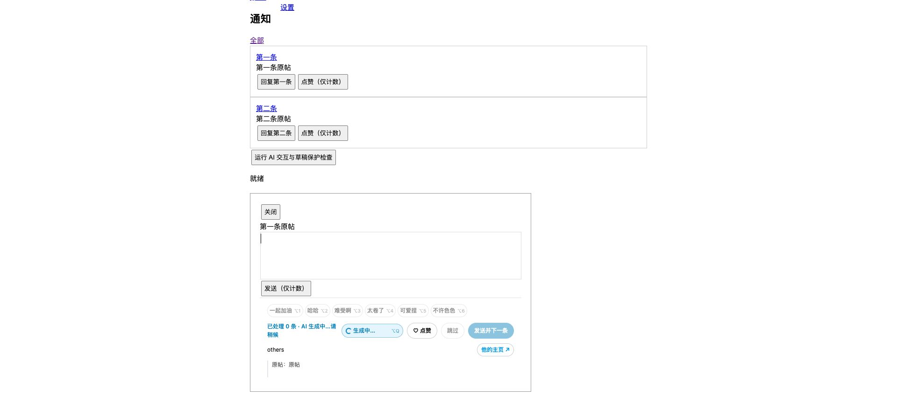

# 0.16.4 · AI 进度提示与六组词句快捷键

## 行为

AI 推荐按钮现在在操作行显示转圈及“生成中…”、“改写中…”、“填入中…”，同时高亮下方状态文字；结束或失败后恢复。自动候选生成也提供状态，不再仅通过灰字和禁用按钮判断是否正在执行。失败原因仍由原有提示显示，不自动重试。

六组短语按如下顺序排列，按钮上直接标记键位，Option+Q 推荐评论保持不变。Windows 对应 Alt。

| 快捷键 | 短语组 |
| --- | --- |
| Option+1 | 一起加油 |
| Option+2 | 哈哈 |
| Option+3 | 难受啊 |
| Option+4 | 太卷了 |
| Option+5 | 可爱捏 |
| Option+6 | 不许色色 |

新两组保留原句，只沿用原有随机末尾标点（`...`、`!`、`!!!`、`!!`）。输入框内按键等同点击对应按钮，追加到草稿末尾，不替换已有内容、不发送、不点赞。组字、框外、忙碌、长按重复与额外修饰键保护沿用原逻辑；数字按物理 Digit1～6 识别，兼容 Option 产生的不同字符。

## 布局与性能

六组短语独占原快捷行，AI 推荐置于下方操作行；尺寸不足时只有短语区域横向滚动，AI 状态始终可见。推荐按钮宽度固定 132px，快捷区域与状态区保持固定高度，状态切换不改变按钮宽度或行高。

复用已有会话状态和按帧刷新。模型请求开始／结束只触发合并后的控件刷新，没有新增全页观察器、JS 轮询、额外模型预取或 X 接口。转圈仅在忙碌时由 CSS transform 动画运行，并尊重减少动态效果设置。快捷短语完全本地执行。

## 验证

- Node 全量测试 **92/92**。
- 本地 Chrome、React 17 / Draft.js 0.11.7、模拟模型 **33/33**：六组显示与快捷键对应、一次填入、防重复、组字／框外不触发、快捷短语零模型请求、生成状态及结束恢复、忙碌期按钮位置和行高一致；原有推荐、自动候选、改写与草稿保护回归通过。
- 本机 Chrome 实际 Option+Q 按键触发了本地模拟生成，截图确认六组键位和生成中提示可见。初始布局将 AI 与词句共排导致可见词句减少，最终改为六组独占快捷行，AI 留在下方操作行。
- 本轮未调用真实模型、未在真实 X 发送或点赞；真实 X 最新布局与不同窄窗口仍需重载后确认。

[结构化检查结果](ai-progress-0.16.4.json)

源码、README、安装包与原安装目录已同步。手动重载到 0.16.4 并刷新 X 生效，互动数据和 API 配置保留。此记录保留发布前的验证范围。
