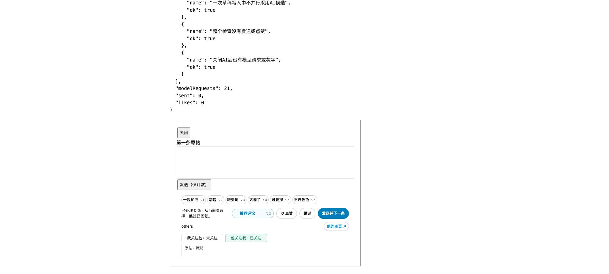

# 0.16.5 · 页面内存中的双向关注

历史说明：本页涉及的双向关注展示及其采集／初始化读取已在 0.16.8 移除。以下保留当时的实现和验证记录。

按用户确认的范围，回复框显示「我关注他」「他关注我」，分别区分已关注、未关注、待确认；回复自己显示不适用。只复用现有正常响应，不查询主页、关注列表或额外 X 接口。

## 数据与性能

- 在 `core.extract` 现有有界遍历中通过可选回调提取用户的 `relationship_perspectives.following/followed_by`；兼容明确的 legacy 布尔值，忽略人数等数字。正常返回的 users/tweets/likes 中没有关注字段。
- MAIN 观察脚本和隔离内容脚本通过独立 `FOLLOW_CONTEXT` 页面消息传递。该消息不进入后台 INGEST、IndexedDB 或 chrome.storage，也不参与互动统计或 AI 请求。
- 两侧各使用一个当前账号的 Map，最多 10,000 个对象；每批消息最多 500 个。按当前评论者用户 ID 直接查询，不逐条查库或查接口。没有新增全页观察器、轮询或列表扫描。
- 刷新、关闭、整页离开或账号切换清空；同一网页的 X 站内列表切换可复用。请求身份未知或切换账号后旧请求返回时，不采用其关注信息。两方向独立按请求顺序更新，缺字段的部分对象不覆盖本页已知字段，旧响应不覆盖新值。
- 页面桥接仍发送当前响应涉及的已知快照，允许另一侧有界缓存淘汰后重新补齐；接收方只有布尔值变化才刷新控件，重复相同状态不重绘、不新增分类请求。

这代表本页最近观察到的状态，不保证实时。没有收到某方向字段或记录被内存上限淘汰时显示待确认；不会把历史「关注了你」通知当作当前状态。当前账号在请求开始时尚无法确认的响应也不用于关注判断，等待后续正常响应即可，不主动补查。

## 位置稳定

回复框一开始就预留独立的 28px 关注行，两项标签各固定宽 132px；已关注、未关注、待确认只变文字和颜色。保留原来的互动标签、主页入口及原帖摘要；关注数据晚到不增删行、不触发原统计重算。

## 验证

- Node 全量测试 **98/98**。新增覆盖：明确 false 与缺字段、两方向独立更新、旧响应、账号切换再切回、未知请求账号、页面清空、容量上限、fetch/XHR 复用、握手前缓存，以及关注消息不调用后台保存和重复状态不重绘。
- Chrome 本地 React/Draft.js、模拟模型 **36/36**。关注初始待确认，更新后位置／宽高／工具栏高度不变，分类请求次数不增；换到另一位无缓存用户恢复待确认。此前 0.16.4 的 AI 进度、六组快捷键及草稿保护一起通过。
- 只读回放以前保留的真实通知响应：46 个关系对象均提取出双向布尔字段；正常持久化 batch 不含关注关系。该归档不代表当前所有接口都会返回字段，未将真实账号数据纳入公开测试文件。
- 本轮未操作真实 X 账号、发送评论、点赞、关注或请求模型。真实新版显示需重载后确认。

[受控交互结果](follow-context-0.16.5.json)

未发现需要增加 X 请求或改用永久存储的问题。源码、README、安装包与原安装目录同步至 0.16.5，包含 0.16.4 的功能。请重载扩展并刷新 X，现有互动记录与 API 配置不变。此记录保留发布前的验证范围。
