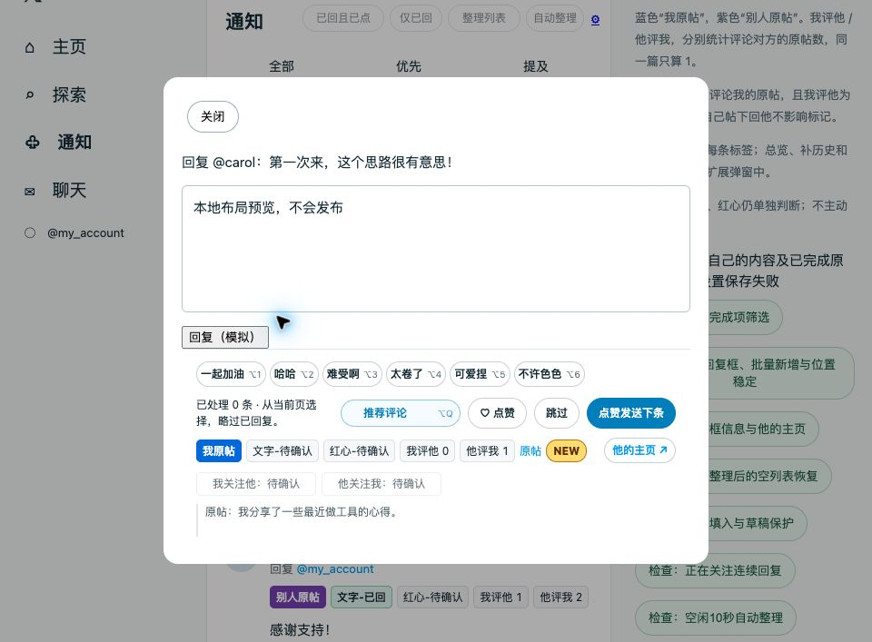

# 0.16.7 · 点赞发送下条

主按钮改为「点赞发送下条」，保持原来的同一行紧凑布局；没有采用整行宽按钮。按钮预留原六字文案的最小宽度，点赞中／等待发送／发送中状态不使按钮缩窄移位。

## 执行顺序

1. 用户写好内容并点击组合按钮。
2. 原生按钮已是已点状态则跳过点赞，不会再点一次取消；否则点击当前帖的原生红心。
3. 新点赞等待本帖、当前账号、当前请求的成功回执，并等同一份本地保存 Promise 完成。
4. 随机等待 `200 + floor(random × 301)` 毫秒，即 200～500ms；实际总时间还包含网络、保存与浏览器调度。
5. 再核对会话、草稿、编辑器、原卡片和原生按钮状态，使用原生回复发送。确认成功并保存回复记录后进入下一条。

每次只处理用户当前确认的一条，不自动发送后续条目。独立红心仍可单独操作；跳过和 X 原生回复不附带点赞。

## 取消与失败

- 等待期间输入、组字或点击回复框其他控件会取消组合发送；关闭、换账号／列表、进入后台或整页离开同样停止后续操作。
- 已成功的点赞不会自动取消。旧请求回执不能触发新操作；连点不重入。
- 取消后马上再次点击，仍未确认的上一笔红心不能冒充已有成功点赞，需等结果或重新打开核对。
- 点赞结果超过 10 秒未确认，或点赞记录保存失败时暂停，不发送、不自动重试。原草稿保留。
- 原卡片已移出或原生点赞／回复按钮不可用时不发送。每阶段只用既有页面控件，不额外查接口。
- 随机等待是一次性定时器，没有轮询；完成、取消或结束会话会清理等待计时器。

## 验证

- Node 全量 **111/111**，新增确认点赞回执携带请求开始时间、控制器复用原保存 Promise、不重复入库。
- 组合流程受控浏览器检查 **12/12**：顺序及保存后等待、已点赞、不重入、改稿、关闭、账号切换、旧回执、未完成点赞的再次确认、保存失败、10 秒超时、跳过和紧凑布局。
- 通知页现有观察器→保存→组合操作 **7/7**；主页为你推荐／正在关注、普通／长评论、一次保存、晚到回执与跨列表保护 **11/11**。
- 旧通知页测试最初在按钮下一帧恢复前就程序点击，未触发操作；改为等待真实可用后通过。最初的跳过用例带有草稿、却没有模拟保存确认，停在原有草稿保护分支；无草稿跳过用例通过，没有放宽生产保护。
- [结构化证据](like-send-0.16.7.json)。均为本地虚构数据和模拟回执，本轮未在真实 X 发送、点赞或调用模型；真实组合操作仍待正常使用确认。

版本包含此前 0.16.6 的首屏账号识别修复。源码、README、安装包及原安装目录已同步；重载到 0.16.7 并刷新 X 生效。此记录保留发布前的验证范围。
